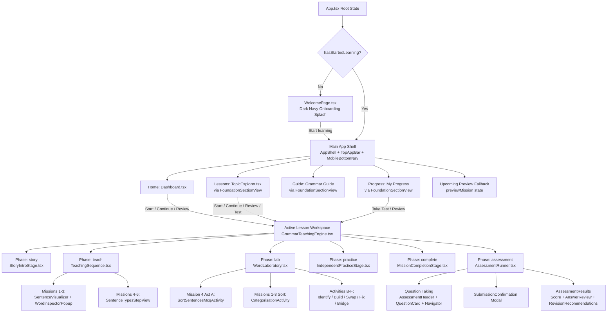
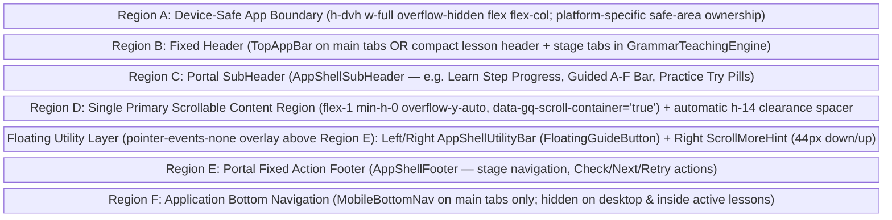

# Grammar Quest — UX Audit, Common Design Pattern System & Screen Mapping Document

> **Document Type**: Living Architectural UX Audit, Design Pattern Specification & Screen Mapping 
> **Scope**: Current implementation review of Grammar Quest (`src/` and Android shell); includes shipped UX updates 
> **Last Updated**: 2026-11-26 
> **Target Audience**: Product Owner, UI/UX Designer, Frontend Engineers 
> **Primary Device Priority**: Mobile-first (`360px`, `390px`, `412px` viewports) with responsive desktop scaling (`>= 768px` / `>= 1024px`)

---

## Global Page-Design and Component-Reuse Rule

Before finalizing any page design, or designing or implementing a new component, consult this design system and the repository-wide instructions in `.github/copilot-instructions.md`. Search the existing component inventory and pattern library first. Reuse an available component or extend its existing implementation; do not recreate or duplicate it. Add a new component only when no existing component or pattern can meet the requirement without compromising its intended behavior, and document the reason and resulting design-system change.

This is a mandatory global workflow for all future page designs and component work.

---

## 1. Executive Summary

Grammar Quest is a mobile-first educational React/TypeScript single-page application teaching English grammar (Classes 9–10, aligned with SEBA, PSEB, and BSE Odisha textbooks) through a structured learning loop: **Story → Learn → Guided Practice (Activities A–F) → Independent Practice → Finish → Formal Test**.

### Architectural Strengths Already in Place
- **Unified Mobile Viewport Shell (`AppShell`)**: Every authenticated/post-welcome screen is framed inside one `100dvh` six-region application shell (`src/components/AppShell/AppShell.tsx`) with a single primary scroll container (`data-gq-scroll-container="true"`), portal-injected SubHeader/UtilityBar/Footer slots, automatic `h-14` bottom clearance, and a persistent two-direction floating scroll indicator (`ScrollMoreHint`).
- **Accessible Modal Foundation (`ModalDialog`)**: Center dialogs and bottom sheets share one portal component (`src/components/Modal/ModalDialog.tsx`) with `#root` inertness, keyboard focus trapping, `Escape` dismissal, backdrop blur, and focus restoration.
- **Single-Owner Android Top Safe Area**: `MainActivity` applies the Android status-bar/cutout inset natively; `AppShell` suppresses its CSS top inset on Android while retaining CSS safe-area handling on web and iOS, preventing the top bar from receiving the same inset twice.
- **Readable Noticeboard Close-Up**: The Story and Finish noticeboard scenes offer a tap-to-zoom close-up in `ModalDialog`; the modal magnifies the active scene artwork and returns to the frame with **Okay** (or Escape).
- **Data-Driven Lesson & Assessment Engines**: Six active lessons (out of 22 catalog topics across 5 curriculum groups) and three formal assessments are cleanly decoupled into versioned JSON definitions (`src/content/class9/`, `src/content/class10/`), indexed via `lessonRegistry.ts`, `assessmentRegistry.ts`, and `curriculumCatalog.ts`, with local IndexedDB persistence (`progressRepository.ts`, `assessmentRepository.ts`).
- **Pedagogically Purposeful Variety**: Rather than forcing every concept into a single quiz template, the app intentionally pairs grammar topics with domain-appropriate interactions (visual timelines for Tenses, agreement locks for Subject–Verb Agreement, clause-structure visualisers for Sentence Types/Voice/Prepositions, token selection, sentence construction, error spotting, and sequential MCQ sorting).

### Core UX & System Inconsistencies Uncovered
1. **Two Competing Visual Token Dialects (+ a Third Onboarding Dialect)**: Newer screens (`Dashboard`, `TopicExplorer`, `SentenceTypesStepView`, `SortSentencesMcqActivity`, `GuideNotePopup`) use warm ivory `#FBF6EA`/`#FBF8F1`, deep navy `#1B2559`, amber `#F6B93B`/`#F2B63A`, green `#1E8E5A`, and pill buttons (`rounded-full`). Older screens and shared primitives (`tokens.css`, `Button`, `Card`, `Badge`, `FoundationSectionView`, `Assessment*`, `IndependentPracticeStage`, `WordLabChallengeActivity`) use off-white `#FDFCF9`, slate-navy `#263A70`, sunshine `#FFC64B`, teal `#1FA89A`/`#D9FAF5`, coral `#F36F68`, and `12px–14px` radii.
2. **Proliferation of Unshared UI Implementations**: Identical educational objects have been implemented repeatedly instead of reusing shared patterns—most notably **5 separate MCQ option implementations**, **6 progress bar implementations**, **4 feedback banner implementations**, **2 star-rating implementations**, and **7 inline CTA button styles bypassing `Button.tsx`**.
3. **Dual Learn-Stage and Dual Sorting Architectures**: Missions 1–3 render Learn steps via `SentenceVisualizer` (opening `WordInspectorPopup` modal on word tap) and Guided Sorting via multi-card `CategorisationActivity`. Missions 4–6 render Learn steps via `SentenceTypesStepView` (inline word-meaning caption, tabbed examples, 3 collapsible accordions), and Mission 4 Activity A uses the redesigned sequential MCQ `SortSentencesMcqActivity`.
4. **Confirmed Sub-44px Touch Targets & Footer Fragmentation**: Multiple interactive controls—including `Button size="sm"` (`40px`), Learn `Steps` trigger (`36px`), Practice `Try 1..N` pills (`38px`), Assessment review filters (`38px`), Topic Explorer active filter chip (`36px`), and `WordGroup` badges (`32px`)—fall below the `44px` minimum mobile touch target. Fixed footers (`Region E`) vary in height (`40px`, `44px`, `52px`) and button layout across stages.
5. **Orphaned / Superseded Components**: `ExplanationPanel.tsx` and `GrammarHighlight.tsx` are exported but unused in the UI, and `ClausePatternCard.tsx` is unreachable for all current lessons because `TeachingSequence` routes every step containing `clausePatternData` directly to `SentenceTypesStepView`.

### Strategic Goal of This Document
Establish a **feature- and object-driven Common Design Pattern System** so future refinements and upcoming lessons (the remaining 16 catalog topics) reuse a concise set of cohesive, mobile-safe patterns—preserving Grammar Quest's warm, approachable identity and pedagogical diversity without visual fragmentation.

---

## 2. Application Architecture Overview

### 2.1 High-Level Navigation & State Routing

Grammar Quest uses state-driven client-side routing inside `src/App.tsx` synchronised with URL hash fragments (`#mission=<id>&phase=<phase>`), plus a dev-only route (`#character-sheet` / `?dev=characters` gated behind `import.meta.env.DEV`).

### 2.2 Six-Region Unified Application Shell (`AppShell.tsx`)

All post-welcome screens execute inside `src/components/AppShell/AppShell.tsx`, enforcing a single `100dvh` viewport boundary and a single vertical scroll container:

On Android, `MainActivity` applies the top and horizontal system insets natively; `AppShell` does not add a second CSS top inset. The bottom inset is handled by the web bottom navigation. Web and iOS retain CSS `env(safe-area-inset-*)` handling.

### 2.3 Curriculum & Stage Availability Across Active Lessons

Inspection of `src/content/curriculumCatalog.ts`, `src/content/lessons/lessonRegistry.ts`, `src/content/assessments/assessmentRegistry.ts`, and all six `src/content/class9/*.json` files reveals three distinct lesson maturity tiers:

| Mission ID | Lesson Title & Topic | Learn Renderer | Story | Learn Steps | Guided (A–F) | Guided Sort UI | Practice Items | Finish Stage | Formal Test |
|---|---|---|---|---|---|---|---|---|---|
| `c9-mission-01` | Repair the Broken Message (Subject & Predicate) | `SentenceVisualizer` | Yes | 7 | 6 (`identify-both`, `categorise`, `sentence-construction`, `word-replacement`, `missing-words`, `error-identification`) | `CategorisationActivity` | 4 (`dual-identify`, `imperative-check`) | Yes | Yes |
| `c9-mission-02` | Journey Through Time (Tenses) | `SentenceVisualizer` (7 `timelineData`) | Yes | 8 | 6 (`identify-group`, `categorise`, `sentence-construction`, `word-replacement`, `missing-words`, `error-identification`) | `CategorisationActivity` | 3 (`token-and-choice`, `choice-diagnose`) | Yes | Yes |
| `c9-mission-03` | The Grammar Detective (Subject–Verb Agreement) | `SentenceVisualizer` (7 `agreementData`) | Yes | 8 | 6 (`identify-group`, `categorise`, `sentence-construction`, `word-replacement`, `missing-words`, `error-identification`) | `CategorisationActivity` | 3 (`token-and-choice`, `choice-diagnose`) | Yes | Yes |
| `c9-mission-04` | Sentence Types & Clause Patterns | `SentenceTypesStepView` (12 `clausePatternData`, 6 checkpoints) | No | 12 | 6 (`categorise`, `identify-group`, `word-replacement`, `sentence-construction`, `error-identification`, `missing-words`) | `SortSentencesMcqActivity` | 6 (`choice-diagnose`, `token-and-choice`, `dual-identify`) | Yes | No |
| `c9-mission-05` | Active and Passive Voice | `SentenceTypesStepView` (11 `clausePatternData`, 7 checkpoints) | No | 11 | 0 (omitted) | N/A | 0 (omitted) | No | No |
| `c9-mission-06` | Prepositions | `SentenceTypesStepView` (11 `clausePatternData`, 6 checkpoints) | No | 11 | 0 (omitted) | N/A | 0 (omitted) | No | No |
| *16 topics* | Upcoming Curriculum Topics | N/A (`Upcoming` badge in `TopicExplorer`) | — | — | — | — | — | — | — |

### 2.4 Learn-Step Pagination and Related Design Changes

The Learn stage now uses one reusable `PaginatedContent` wrapper for both existing lesson renderers (`SentenceVisualizer` and `SentenceTypesStepView`). It measures the available height in the existing `AppShell` scroll region and packs marked content blocks in their original order; it does not introduce another scroll container or split a marked block.

- Pagination is enabled only when total measured block height exceeds `1.25 ×` the available height. Pages are packed to `90%` of that height; an underfilled final page below `25%` is merged into the preceding page.
- `PAGINATE_THRESHOLD`, `PAGE_FILL`, and `MIN_LAST_PAGE_FILL` live together in `src/features/grammar-engine/pagination/pagination.ts`. Content blocks can declare `keepWithNext` and `pageBreakBefore` through their data markers.
- Pages remain mounted so interaction state is retained. The wrapper remeasures on content-step or viewport/font-size changes, not when accordions open or close.
- The existing `LessonNavigation` controls move between sub-pages and lesson steps. Back from page one returns to the preceding step's last page; Next enters the next step at page one. Scroll returns to the top when changing sub-pages.
- Multi-page steps show an accessible `Page N of M · <page name>` status and current/visited/unvisited dots below the existing progress row. The indicator is hidden for single-page steps.
- The Exclamatory/Interrogative check in Mission 4 Step 2 now uses a dashed clue panel with a magnifier, two checked clues, and a verdict. Its existing grammar information is retained, and the panel is visually distinct from selectable sentence cards.
- The repository-wide pagination and design-reuse rules are recorded in `.github/copilot-instructions.md`.

The change is limited to Learn-stage presentation and navigation; lesson sequence, learning content, scoring, and other stages are unchanged.

---

## 3. Complete Application Screen Inventory

Every screen, stage, sub-screen, and overlay present in the codebase is catalogued below from direct inspection of `src/App.tsx`, `src/features/`, and `src/components/`.

### 3.1 Entry & Main Navigation Screens

| # | Screen / View | Source File(s) | Purpose & Main User Task | Existing Components & Important Content Objects | Interaction Types | Layout & Scrolling | Visual & UX Notes |
|---|---|---|---|---|---|---|---|
| S01 | **Welcome / Onboarding Splash** | `src/features/home/WelcomePage.tsx` | First-launch entry; invite learner to enter the app. | Shukaji mascot PNG (`/assets/shukaji.png`), floating grammar chips (`Tenses`, `Voice`, `Clauses`, `Prepositions`), title `"Grammar Quest"`, subtitle, 3D pill CTA `"Start learning"`. | Single primary button tap. | Standalone `min-h-dvh` centered layout outside `AppShell`; no bottom nav. | Uses dark navy `#1F2A68`, `Baloo 2` + `Nunito` fonts, and yellow 3D button—intentionally distinct from study screens, though typography/tokens are completely isolated. |
| S02 | **Home Dashboard** | `src/features/home/Dashboard.tsx` | Orient learner, summarise overall progress, and launch the next recommended lesson. | `AppShell`, `TopAppBar`, `MobileBottomNav`, `WelcomeTrioIllustration`, `HeroCard`, `My Progress` card with linear bar & `Explore all lessons` button, `Up next` highlight card (`#FDEBC0`) or `All caught up` card, `Also ready` compact lesson list (up to 3). | Tapping primary lesson CTA, secondary lesson rows, or `"Explore all lessons"`. | Single `AppShell` vertical scroll on `#FBF6EA` canvas; `ScrollMoreHint` active if overflowing. | Mobile brand bar is `48px` high; Android status-bar inset is handled once by the native shell. |
| S03 | **Lessons Explorer** | `src/features/missions/TopicExplorer.tsx` (rendered by `FoundationSectionView.tsx`) | Browse, search, and filter all 22 curriculum topics across 5 groups; launch lessons or gated tests. | Search input pill with clear button, circular navy Filter trigger, 4-column status segmented bar (`All`, `Ready`, `Completed`, `Coming soon`), dismissible active group chip, `Expand all / Collapse all` control, 5 collapsible group accordions, lesson rows with status/time/concept summary + pill CTAs (`Start`, `Continue`, `Review`, `Test`). | Text search, bottom-sheet group filter, segmented status filter, accordion toggle, lesson/test launch. | Single `AppShell` scroll on `#FBF6EA`. | Filter trigger uses good `44px` hit target, but dismissible group chip is `min-h-[36px]`; pill buttons bypass `Button.tsx`; redundant `"Back to Home"` link at top despite bottom nav. |
| S04 | **Grammar Guide** | `src/features/placeholders/FoundationSectionView.tsx` (`section="guide"`) | Quick-reference cheat-sheet of foundational grammar concepts. | `"Back to Home"` ghost button, header block, stacked `Card` (`variant="white"`) items rendering `GUIDE_CONCEPT_NOTES` (title, summary, rule/example notes). | Reading and scrolling. | Single `AppShell` scroll on `#FBF6EA`. | Uses legacy `tokens.css` palette (`#263A70`, `#E5E2D9`) inside a `#FBF6EA` warm canvas; redundant `"Back to Home"` button at top. |
| S05 | **My Progress** | `src/features/placeholders/FoundationSectionView.tsx` (`section="progress"`) | Review overall completion percentage, per-lesson stage milestones, and launch tests or reviews. | `"Back to Home"` ghost button, overall `Card` with `<Progress>` (`h-3` `#24B5A5`), per-lesson cards with status `Badge`, stage completion pills (`Learn`, `Practice`, `Test`), best assessment score, and `<Button size="sm">` CTAs. | Tapping `Review Lesson` / `Continue` / `Take Test`. | Single `AppShell` scroll on `#FDFCF9` (different canvas from Home/Lessons/Guide!). | Uses `<Button size="sm">` (`40px` touch target); canvas colour `#FDFCF9` mismatches `#FBF6EA` used on the other three main tabs. |
| S06 | **Upcoming Lesson Preview Fallback** | `src/features/placeholders/FoundationSectionView.tsx` (`previewMission` mode) | Inform learner when an unavailable/upcoming mission is selected directly. | Preview `Card` with badge, description, and `"Back to Home"` button. | Navigation back. | Single `AppShell` scroll. | Edge-case fallback state; rarely reached since upcoming rows in `TopicExplorer` render non-interactive `"Soon"` badges. |

### 3.2 Active Lesson Workspace & Learning Stages (`GrammarTeachingEngine.tsx`)

All lesson stages share the `GrammarTeachingEngine` wrapper (`src/features/grammar-engine/components/GrammarTeachingEngine.tsx`): compact sticky header (44px Back button + lesson title/module + equal-width stage tabs `Story | Learn | Guided | Practice | Finish | Test` with `#F6B93B` active tab) inside `AppShell` (no `MobileBottomNav`).

| # | Stage / View | Source File(s) | Purpose & Main User Task | Existing Components & Important Content Objects | Interaction Types | Layout & Scrolling | Visual & UX Notes |
|---|---|---|---|---|---|---|---|
| S07 | **Story Intro Stage** | `src/features/grammar-engine/components/StoryIntroStage.tsx` | Contextualise the grammar problem via narrative beats (Missions 1–3 only). | `CourtyardNoticeboardScene`, scattered broken-message chips, typewriter dialogue bubble with speaker avatar & diamond pointer, progress dots, `Skip intro` link, `AppShellFooter` (`LessonNavigation`). | Step through beats (Back / Pause-Replay / Next) or Skip; tap the board or **Read board** to open its close-up. | Single `AppShell` scroll + fixed `Region E` footer. | Engaging narrative hook; the close-up enlarges the active board artwork so small labels are easier to read. |
| S08 | **Learn Stage — Legacy Visualizer (Missions 1–3)** | `TeachingSequence.tsx` + `PaginatedContent.tsx` + `SentenceVisualizer.tsx` + `WordToken.tsx` + `WordGroup.tsx` + `LessonNavigation.tsx` | Teach grammar step-by-step via animated sentence breakdowns, timelines, and agreement locks. | `AppShellSubHeader` (`Step X of N`, `#F6B93B` bar, `Steps` button), `SentenceVisualizer` (`plain-sentence`, `group-bracket`, `meaning-callout`, `structure-split`, `guided-explore`, `compare-dual`, `timeline-shift`, `agreement-lock`, `free-explore`), tappable tokens opening `WordInspectorPopup`, page indicator for multi-page steps, `AppShellUtilityBar` (`FloatingGuideButton`), `AppShellFooter` (`LessonNavigation`). | Tap words for modal inspection, toggle view controls/compare traps, use Back/Next for page and step navigation, open Guide Note or Steps popover. | Single `AppShell` scroll + fixed SubHeader + floating UtilityBar + fixed Footer; long Learn steps paginate measured blocks. | `Steps` button (`36px`), `WordGroup` badge (`32px`), and visualizer control chips (`40px`) remain under `44px`; word-tap opens a full modal, unlike Missions 4–6. |
| S09 | **Learn Stage — Modern Clause/Pattern View (Missions 4–6)** | `TeachingSequence.tsx` + `PaginatedContent.tsx` + `SentenceTypesStepView.tsx` + `LessonNavigation.tsx` | Teach multi-part grammar concepts with interactive breakdowns, leveled examples, inline Quick Check, and deep-dive accordions. | `AppShellSubHeader`, `Starter / Compare` switcher, concept buttons (`Subject`, `Predicate`, `Structure`), tappable inline words with stable inline meaning caption, segment tile grid + live sentence strip, relation diagram, `Easy / Medium / Challenging` example tabs, inline Quick Check radio card, dashed Exclamatory/Interrogative clue panel, lavender Remember callout, 3 collapsible accordions, page indicator for multi-page steps, `FloatingGuideButton`, `LessonNavigation`. | Tap words for inline caption, switch Starter/Compare & difficulty tabs, answer inline Quick Check, expand/collapse accordions, navigate sub-pages and steps with existing Back/Next controls. | Single `AppShell` scroll + fixed SubHeader + floating UtilityBar + fixed Footer; long Learn steps paginate measured blocks. | Quick Check uses a distinct clue-panel style; `Starter/Compare` and difficulty tabs remain `min-h-[40px]`, and visual architecture diverges sharply from Missions 1–3. |
| S10 | **Guided Practice Shell (Activities A–F)** | `src/features/grammar-engine/components/WordLaboratory.tsx` | Orchestrate up to 6 hands-on guided activities (A–F) with completion tracking and stage progression. | `AppShellSubHeader` single-row A–F tab strip (active wider navy tab e.g. `A Sort`, inactive 44px letter/check square tabs), active sub-activity view, `AppShellFooter` (activity progress label + `Previous` / `Next Activity` / `Continue to Practice`, or delegated footer for `SortSentencesMcqActivity`). | Switch A–F tabs, complete sub-activities, advance stages. | Single `AppShell` scroll + fixed SubHeader + fixed Footer. | Compact A–F tab bar fits 360px cleanly without horizontal scrolling; footer varies between delegated (`SortSentencesMcqActivity`) and generic (`WordLaboratory`) with an unlabelled `RotateCcw` icon on legacy sort. |
| S10a | **Guided Sub-Activity: Sequential MCQ Sort (Mission 4 Act A)** | `src/features/grammar-engine/components/SortSentencesMcqActivity.tsx` | Classify 8 sentences one-by-one into 4 sentence purposes (`Statement`, `Question`, `Command`, `Exclamation`) with immediate feedback and star scoring. | Header (`A. Sort Sentences by Purpose`, `Question X of 8`, live 3-star counter), 8-segment progress bar, sentence prompt card (`#FFFDF6`), reserved `min-h-[68px]` feedback box, 4 full-width option rows (icon + title + meaning + check/X), completion card (`"All 8 sorted"` + stars + `Retry` button), delegated `AppShellFooter` (`Next sentence` / `Next: B Verbs`). | Tap option, retry on wrong answer (with shake), tap `Next sentence`, or `Retry` at completion. | Single `AppShell` scroll on `#FBF8F1`, fixed Footer. | Gold-standard mobile-first activity layout (`>= 44px` targets, zero layout shift via reserved feedback region, `touch-manipulation`), though uses inline styles/tokens (`#1B1B1F`, `#F2B63A`, `#1E8E5A`) not yet codified in `tokens.css`. |
| S10b | **Guided Sub-Activity: Multi-Card Categorisation (Missions 1–3 Sort)** | `src/features/grammar-engine/components/CategorisationActivity.tsx` | Sort multiple phrase/sentence cards into category boxes via drag-and-drop or tap-to-place. | Header + `CelebrationStars`, ShukaJi guide bubble + `Hint` button (`44px`), pool of draggable/tappable sentence cards (`44px`), 2–4 colour-coded category drop zones with `"Tap to place here"` buttons (`48px`), completion banner. | Drag-and-drop or tap card → tap category box, tap `Hint`. | Single `AppShell` scroll; long vertical stack on small phones when 6–8 cards + 2–4 boxes are visible simultaneously. | Works functionally, but causes high vertical scroll effort and split-attention between top card pool and bottom category boxes on 360px screens; starkly inconsistent with Mission 4 Act A. |
| S10c | **Guided Sub-Activity: Identify Group / Identify Both** | `IdentifyGroupActivity.tsx`, `IdentifyBothActivity.tsx` | Tap words belonging to a target grammar group (or Subject first, then Predicate). | Prompt, `ActivityCharacterNote`, `WordToken` row, `PracticeFeedback`, `<Button size="sm">` Check / Clear / Show Hint controls. | Multi-select word tokens, Check answer, Clear. | Single `AppShell` scroll. | Uses `Button size="sm"` (`40px`) and legacy teal/coral feedback; clean token interaction. |
| S10d | **Guided Sub-Activity: Sentence Builder (Construction)** | `SentenceBuilder.tsx`, `WordTile.tsx` | Assemble scrambled word/phrase tiles into a grammatically valid sentence. | Prompt, `ActivityCharacterNote`, answer slots area, tappable `WordTile` bank, `PracticeFeedback`, `<Button size="sm">` Check / Reset / Hint controls. | Tap tiles to move between bank and sentence slots, Check, Reset. | Single `AppShell` scroll. | Clear tactile tile construction; `Button size="sm"` is `40px`. |
| S10e | **Guided Sub-Activity: Word Replacement / Missing Words / Error Identification** | `WordLabChallengeActivity.tsx` (`WordReplacementView`, `MissingWordsView`, `ErrorIdentificationView`) | Swap a highlighted word, pick a missing bridge/connector, or identify/fix an error in a sentence. | Prompt, `ActivityCharacterNote`, sentence card with highlighted slot/error, option buttons (`min-h-[48px]`, `aria-pressed`), `ActivityHintBox`, `PracticeFeedback`. | Single-choice selection, optional hint toggle. | Single `AppShell` scroll. | Good `48px` option heights, but implements its own bespoke MCQ option styling separate from `AnswerOption`, `SortSentencesMcqActivity`, and `IndependentPracticeStage`. |
| S11 | **Independent Practice Stage** | `src/features/grammar-engine/components/IndependentPracticeStage.tsx` | Apply lesson concepts across 3–6 multi-mode mastery challenges without step-by-step scaffolding. | `AppShellSubHeader` (`Try 1..N` pills), prompt card, 4 interactive modes (`dual-identify`, `token-and-choice`, `imperative-check`, `choice-diagnose`), `ActivityHintBox`, `PracticeFeedback`, completion celebration banner with hardcoded `CelebrationStars` (`stars={3}`), `AppShellFooter` (`Back` / `Next Challenge` / `Finish Lesson`). | Token selection + MCQ choice depending on item mode; hint toggle; navigate Try pills. | Single `AppShell` scroll + fixed SubHeader + fixed Footer. | `Try 1..N` pills are `min-h-[38px]`; MCQ markup duplicates `WordLabChallengeActivity`; footer uses `<Button size="sm">` (`40px`). |
| S12 | **Mission Completion Stage (Finish)** | `src/features/grammar-engine/components/MissionCompletionStage.tsx` | Celebrate lesson completion, recap key takeaways, show restored messages, and offer next step (Test or Home). | Repaired `CourtyardNoticeboardScene`, 3 celebrating character portraits, `"What you learned"` checklist, restored messages grid, milestone card, `AppShellFooter` (`Back to Home`, `Review Lesson`, gated `Take Lesson Test`). | Review summary, open the repaired board close-up, navigate to Test, Review Lesson, or Home. | Single `AppShell` scroll + fixed Footer. | Footer has 3 `flex-wrap` `<Button size="sm">` (`40px`) buttons that can wrap into 2 rows on 360px screens, shrinking visible content height. |

### 3.3 Assessment Engine Screens (`src/features/assessment/`)

| # | Screen / Sub-Screen | Source File(s) | Purpose & Main User Task | Existing Components & Important Content Objects | Interaction Types | Layout & Scrolling | Visual & UX Notes |
|---|---|---|---|---|---|---|---|
| S13 | **Formal Test — Question Taking** | `AssessmentRunner.tsx`, `AssessmentHeader.tsx`, `QuestionCard.tsx`, `AnswerOption.tsx`, `QuestionNavigator.tsx` | Complete a timed-free formal multiple-choice lesson test with free navigation and deferred grading. | `AssessmentHeader` (title, redundant `"Back to Lesson Stages"` button, answered counter + `#263A70` progress bar), `QuestionCard` (question badge, prompt, sentence callout), `AnswerOption` (`role="radio"`, A–D badge, neutral `#FFF1D5` selection), `QuestionNavigator` (collapsible question grid with answered/current indicators), `AppShellFooter` (`Previous`, `Next` / `Submit Test`). | Select radio option, jump via Question Navigator, navigate Prev/Next, trigger Submit confirmation. | Single `AppShell` scroll + fixed Footer. | Clear exam neutrality (no premature right/wrong feedback); however `"Back to Lesson Stages"` inside body duplicates the top `GrammarTeachingEngine` header controls, and footer uses `Button size="sm"` (`40px`). |
| S14 | **Formal Test — Results, Answer Review & Revision** | `AssessmentResults.tsx`, `AnswerReview.tsx`, `RevisionRecommendations.tsx` | View final score, earned stars, pass/mastery summary, inspect every question's explanation, and jump to recommended review steps. | Score summary card (`CelebrationStars` + % score + passed/needs-review copy), `RevisionRecommendations` (weak-area topics with `"Review Learn Step"` action buttons), `AnswerReview` (filter bar `All / Review / Correct` + per-question status cards showing user answer, correct answer, and explanation), `AppShellFooter` (`Retake Test`, `Back to Lesson` / `Back to Home`). | Filter reviewed questions, jump directly to a Learn step, retake test, return Home. | Single `AppShell` scroll + fixed Footer. | `All / Review / Correct` filter buttons are `min-h-[38px]`; footer uses `Button size="sm"` (`40px`). |

### 3.4 Overlays, Popovers & Internal Tools

| # | Overlay / Utility | Source File(s) | Trigger & Dismissal | Existing Components & Purpose | Layout & Accessibility Notes |
|---|---|---|---|---|---|
| O01 | **Guide Note Popup (ShukaJi)** | `src/features/grammar-engine/components/GuideNotePopup.tsx` | Auto-opens once per unseen Learn step OR manually via `FloatingGuideButton`. Dismissed ONLY via `"Okay, got it"` button (`closeOnBackdropClick={false}`). | Centered `ModalDialog`, ShukaJi avatar + title + concise grammar explanation + optional textbook note, rounded-full `52px` navy CTA. | Accessible focus trap via `ModalDialog`; `closeOnBackdropClick={false}` guarantees acknowledgement but may feel forceful when stepping rapidly through Learn. |
| O02 | **Word Inspector Popup** | `src/features/grammar-engine/components/WordInspectorPopup.tsx` | Tapping any interactive `WordToken` in `SentenceVisualizer` (Missions 1–3 only). Dismissed via Close button, backdrop tap, or Escape. | Centered `ModalDialog` showing tapped word, grammatical role badge, function explanation, and contextual rule. | Accessible via `ModalDialog`; inconsistent with Missions 4–6 (`SentenceTypesStepView`), which reveal word meaning inline without interrupting flow. |
| O03 | **Topic Filter Bottom Sheet** | `src/features/missions/TopicExplorer.tsx` (using `ModalDialog placement="bottom-sheet"`) | Tapping circular navy Filter icon beside search bar on Lessons screen. Dismissed via option tap, Close, backdrop, or Escape. | Bottom-sheet `ModalDialog` listing `"All topics"` + 5 curriculum groups with topic counts and active checkmark. | Strong mobile bottom-sheet pattern; `44px+` rows, crisp dismissal. |
| O04 | **Assessment Submission Confirmation** | `src/features/assessment/components/SubmissionConfirmation.tsx` | Tapping `"Submit Test"` in `AssessmentRunner`. | Centered `ModalDialog` warning of unanswered count (if any) with `"Review Answers"` and `"Submit Test"` buttons. | Accessible `ModalDialog`; clear high-stakes confirmation. |
| O05 | **Learn Steps Jump Popover** | `src/features/grammar-engine/components/TeachingSequence.tsx` (`lesson-steps-popover`) | Tapping `Steps` button (`min-h-[36px]`) in Learn `AppShellSubHeader`. | Inline dropdown (`absolute top-full max-h-[50dvh] overflow-y-auto`) listing all step titles with current/visited status. | **Confirmed gap**: Does NOT use `ModalDialog`, has no backdrop, no click-outside handler, and no `Escape` key handler; trigger button is `36px`. |
| O06 | **Floating Guide Button + Hint Toast** | `src/features/grammar-engine/components/FloatingGuideButton.tsx` | Rendered in `AppShellUtilityBar` during Learn stage. | `56px` circular ShukaJi button with amber `"i"` badge; displays a 4.5s floating tooltip after first auto-popup dismissal. | Positioned inside floating utility layer above `Region E`; `56px + 12px bottom offset = 68px` slightly exceeds `AppShell`'s `56px` (`h-14`) bottom clearance spacer. |
| O07 | **Two-Direction Scroll Indicator** | `src/components/ScrollMoreHint/ScrollMoreHint.tsx` | Automatically shown inside `AppShell` floating utility layer whenever `scrollHeight - clientHeight > 16px`. | `44px` circular navy button: downward arrow at top/middle (scrolls by about 72% of visible height, minimum `200px`, and snaps to the end when near enough), upward arrow within `24px` of bottom (scrolls smoothly to top). | Clean, predictable two-direction indicator; never hides mid-scroll. |
| O08 | **Character Reference Sheet (Dev-Only)** | `src/features/characters/CharacterReferenceSheet.tsx` | Only available when `import.meta.env.DEV` via `#character-sheet` or `?dev=characters`. | Internal art-direction QA tool inspecting character portraits, poses, and expressions. | Not student-facing; excluded from learner pattern convergence priorities. |
| O09 | **Noticeboard Close-Up** | `src/components/illustrations/CourtyardNoticeboardScene.tsx` using `ModalDialog` | Tap the noticeboard or **Read board**; close with **Okay** or Escape. | Centered dialog showing a magnified crop of the active noticeboard scene; does not replace or duplicate the scene content. | Accessible modal focus handling; return focus to the trigger after dismissal. |

---

## 4. UI Object Inventory

Every recurring UI object observed across Grammar Quest is catalogued below with all seven required attributes.

| Object Category | UI Object | Where It Appears | Current Variants in Codebase | Interactive or Display | Content Structure | User Expectation | Consistency Status |
|---|---|---|---|---|---|---|---|
| **Navigation** | **Top App Bar** | Home, Lessons, Guide, Progress (`Header.tsx`) | 1 (`TopAppBar`: `48px` mobile / `64px` desktop, logo + title + desktop nav links) | Interactive (desktop nav) / Display (mobile brand) | Brand mark + `"Grammar Quest"` + 4 desktop tabs | Persistent brand anchor and top-level switching on desktop | **Consistent** |
| **Navigation** | **Mobile Bottom Navigation** | Home, Lessons, Guide, Progress (`Header.tsx`) | 1 (`MobileBottomNav`: 4 equal tabs `Home`, `Lessons`, `Guide`, `Progress`) | Interactive | Icon + 1-word label + active indicator | Thumb-reachable primary section switching; hidden inside active lessons | **Consistent** |
| **Navigation** | **Lesson Compact Header & Stage Tabs** | All active lessons (`GrammarTeachingEngine.tsx`) | 1 (44px Back button + title/subtitle + equal-width stage tabs with `#F6B93B` active state) | Interactive | Back button, lesson title, module subtitle, 1–6 stage tabs (`Story`, `Learn`, `Guided`, `Practice`, `Finish`, `Test`) | Immediate orientation within lesson lifecycle and direct stage switching | **Consistent** |
| **Navigation** | **Sub-Stage / Activity Tab Bar** | Learn `Steps` (`TeachingSequence`), Guided `A–F` (`WordLaboratory`), Practice `Try 1..N` (`IndependentPracticeStage`), Review filter (`AnswerReview`), Example tabs (`SentenceTypesStepView`) | **5 variants**: dropdown popover (`36px`), expanding navy letter tabs (`44px`), horizontal pill strip (`38px`), segmented filter (`38px`), 2/3-col pill switcher (`40px`) | Interactive | Short code/label + optional checkmark/count | Quick switching between sub-items without losing context or wrapping awkwardly | **Inconsistent** (heights `36–44px`, styles & active colours diverge) |
| **Navigation** | **Fixed Bottom Action Footer** | Story, Learn, Guided A–F, Practice, Finish, Test, Test Results | **4 variants**: `LessonNavigation` (`52px` Back/Pause/Replay/Next), `SortSentencesMcqActivity` (`44px` 1–2 buttons), `WordLaboratory` (`44px` counter + icon + Next), `<Button size="sm">` footers (`40px` 2–3 wrapping buttons in Practice/Finish/Test) | Interactive | Secondary left action + primary right action (+ optional center media controls) | Predictable thumb-zone progression at bottom of screen; single row on mobile | **Inconsistent** (heights `40–52px`, wrapping in Finish, unlabelled reset icon in legacy Sort) |
| **Learning** | **Lesson / Topic List Row** | Home (`Dashboard.tsx` `Also ready`), Lessons (`TopicExplorer.tsx`), Progress (`FoundationSectionView.tsx`) | **3 variants**: compact Home row, expandable group row with pill CTA + gated Test pill (`TopicExplorer`), Progress card with milestone pills (`FoundationSectionView`) | Interactive | Title, concept summary/meta, status badge/pill, 1–2 action buttons | Quickly assess readiness/progress and jump into lesson or test | **Moderately Inconsistent** (button shapes & colour dialects differ) |
| **Learning** | **Sentence Display / Prompt Block** | `SentenceVisualizer`, `SentenceTypesStepView`, `SortSentencesMcqActivity`, `WordLabChallengeActivity`, `Identify*`, `IndependentPracticeStage`, `QuestionCard` | **5 variants**: interactive token strip, live segment strip, boxed cream sentence card (`#FFFDF6`), quoted callout box (`#FDFCF9`), question card callout | Display or Interactive (when tokens tappable) | Highlighted target sentence with optional role colour coding or blank marker | Instant readability at `>= 17–19px`, clear separation from instructions | **Moderately Inconsistent** (typography scale and surface tints vary) |
| **Learning** | **Interactive Word Token / Tile** | `WordToken.tsx` (Learn 1–3, Identify, Practice), `SentenceTypesStepView.tsx` (Learn 4–6 inline chips), `WordTile.tsx` (Sentence Builder) | **3 variants**: `WordToken` (modal-triggering or selectable), inline word chips (inline caption), draggable/tappable `WordTile` | Interactive | Single word or phrase + optional role/selection border | Tapping clearly highlights word and either explains its role or toggles selection | **Divergent Behaviour** (modal vs inline meaning on Learn word tap) |
| **Learning** | **Rule / Remember / Grammar Callout** | `SentenceTypesStepView` (lavender Remember box `#ECE6FB`), `SentenceVisualizer` (callout banners), `FoundationSectionView` (Guide cards), `GuideNotePopup` | **4 variants**: lavender Remember aside, yellow/cream highlight box, white guide card, modal popup | Display | Icon + short heading + 1–3 sentence rule/takeaway | Scannable anchor for the key rule to remember | **Moderately Inconsistent** |
| **Learning** | **Collapsible Deep-Dive Accordion** | `SentenceTypesStepView` (`Why does this work?`, `Common mistake`, `Grammar note`), `TopicExplorer` (5 curriculum groups), `QuestionNavigator` (collapsible grid) | **3 variants**: animated CSS grid-row icon accordions (`56px` header), curriculum group accordion, dashed/bordered question navigator | Interactive | Icon + title + subtitle + `Show/Hide` chevron | Optional progressive disclosure without bloating initial mobile viewport | **Consistent Pattern, Unshared Code** |
| **Interactive** | **Multiple-Choice Option Row** | `AnswerOption.tsx` (Assessment), `SortSentencesMcqActivity.tsx` (Guided A), `WordLabChallengeActivity.tsx` (Guided E/F), `IndependentPracticeStage.tsx`, `SentenceTypesStepView.tsx` & `ClausePatternCard.tsx` (Quick Check) | **5 separate implementations** with differing ARIA roles (`radio` vs `aria-pressed`), icons/letter badges, heights (`44–56px`), and semantic colours | Interactive | Full-width tappable row with label (+ optional letter/icon/subtext + right state indicator) | Single-tap selection, unambiguous selected/correct/wrong state, no double-tap zoom | **Highly Inconsistent** |
| **Interactive** | **Category Sorting Workspace** | `SortSentencesMcqActivity.tsx` (Mission 4 Act A) vs `CategorisationActivity.tsx` (Missions 1–3 Sort) | **2 completely different paradigms**: sequential 1-sentence MCQ vs multi-card drag/tap into 2–4 category boxes | Interactive | Sentence(s) + 2–4 grammar categories + hint/star tracking | Classify sentences smoothly on mobile without excessive scrolling | **Highly Inconsistent** |
| **Interactive** | **Primary / Secondary Action Button** | App-wide | **7+ variants**: `Button.tsx` (`#FFC64B` primary / `#263A70` navy, `12–14px` radius, `sm=40px`) + inline `#1B2559` buttons in `Dashboard`, `LessonNavigation`, `SortSentencesMcqActivity` + `rounded-full` pills in `TopicExplorer`, `GuideNotePopup`, `WelcomePage` | Interactive | Label + optional leading/trailing Lucide icon | Clear visual distinction between primary CTA, secondary action, and ghost link | **Highly Inconsistent** |
| **Interactive** | **Search Bar & Filter Trigger** | `TopicExplorer.tsx` | 1 (rounded-full search input with clear button + circular `44px` navy filter button + bottom sheet) | Interactive | Search icon, input, clear `×`, filter icon with badge dot | Fast narrowing of 22+ topics on mobile | **Consistent** (only active filter chip is `36px`) |
| **Interactive** | **Hint Trigger & Hint Box** | `CategorisationActivity` (`Hint` button `44px`), `ActivityCharacterNote.tsx` (`ActivityHintBox` toggle), `Identify*`, `SentenceBuilder`, `WordLabChallengeActivity`, `IndependentPracticeStage` | **2 variants**: ShukaJi guide bubble + `Hint` button (reduces star score) vs collapsible `ActivityHintBox` (no star penalty) | Interactive | Trigger button + revealed short guidance text | Help when stuck without giving away the entire answer immediately | **Moderately Inconsistent** |
| **Feedback** | **Immediate Answer Feedback Banner** | `PracticeFeedback.tsx`, `SortSentencesMcqActivity.tsx`, `SentenceTypesStepView.tsx` (Quick Check), `AnswerReview.tsx` | **4 variants**: `PracticeFeedback` (teal `#D9FAF5` / coral `#FEE8E7`), `SortSentencesMcqActivity` (reserved `min-h-[68px]` green `#EDF9F3` / orange-red `#FFF4EE`), Quick Check (`#E2F5EE` / `#FDECE8`), `AnswerReview` cards | Display (`aria-live="polite"`) | Status icon + bold verdict + short grammar explanation | Immediate confirmation or constructive correction without layout jump | **Inconsistent** (colours, layout-shift reservation, and markup differ) |
| **Feedback** | **Star Rating Display** | `CelebrationStars.tsx` (`CategorisationActivity`, `IndependentPracticeStage`, `AssessmentResults`), inline star loop (`SortSentencesMcqActivity`) | **2 UI components**, **3 scoring rules** (`computeSortStars`, `% thresholds`, hardcoded `stars={3}` in Practice) | Display | 3 stars (filled amber vs muted track) | Reward mastery transparently | **Inconsistent** (both UI and scoring semantics) |
| **Feedback** | **Character Companion Note / Guide** | `StoryIntroStage` (dialogue card), `GuideNotePopup` + `FloatingGuideButton` (ShukaJi modal), `ActivityCharacterNote` (inline mascot strip), `CategorisationActivity` (ShukaJi bubble), `MissionCompletionStage` (celebrating trio) | **5 contextual forms** of mascot guidance | Display / Interactive trigger | Portrait avatar + short conversational guidance | Friendly, encouraging mentorship without cluttering activity cards | **Purposefully Varied, Needs Token Alignment** |
| **Structural** | **Progress Indicator** | `Progress.tsx` (My Progress), `Dashboard.tsx`, `TeachingSequence.tsx`, `AssessmentHeader.tsx`, `SortSentencesMcqActivity.tsx`, `StoryIntroStage.tsx` | **6 implementations**: `h-3` teal bar, `h-2.5` teal bar, `h-2` amber bar, `h-2` navy bar, 8-segment bar, expanding dots | Display (`role="progressbar"` on some) | Track + fill (+ optional `X of Y` / `%` label) | Clear sense of position and remaining effort | **Highly Inconsistent** |
| **Structural** | **Content Card Container** | `Card.tsx` (`white`, `cream`, `turquoise`) + inline `rounded-[18px–22px]` cards across Dashboard, TopicExplorer, SentenceTypesStepView, SortSentencesMcqActivity | **2 dialects**: `Card.tsx` (`#FFFFFF` / `#FFF8E8` / `#E4F7F4`, `#E5E2D9`, `20px`) vs inline warm cards (`#FFFDF6` / `#FDEBC0`, `#E9E1CB` / `#E4DCC6`, `18–22px`) | Display | Rounded container with border, soft shadow, `14–20px` padding | Clear grouping of related educational content | **Inconsistent** |
| **Structural** | **Status / Metadata Badge** | `Badge.tsx` (`neutral`, `sunshine`, `turquoise`, `coral`, `navy`) + inline pills in `TopicExplorer`, `FoundationSectionView`, `SentenceTypesStepView` | `Badge.tsx` (`rounded-[8px]`) + numerous inline `rounded-full` / `rounded-[6px]` status tags | Display | Short uppercase or title-case label (`Ready`, `Completed`, `Soon`, `Correct`, `Concept`) | Fast scanning of state or grammatical category | **Inconsistent** |
| **Structural** | **Modal Dialog / Bottom Sheet** | `ModalDialog.tsx` (`center` & `bottom-sheet`) + inline popover in `TeachingSequence.tsx` | 1 canonical `ModalDialog` used by five overlays + 1 ad-hoc dropdown popover (`lesson-steps-popover`) | Interactive overlay | Backdrop + framed panel + title + close control | Focused interruption with reliable keyboard & tap-outside exit | **Mostly Consistent** (`Steps` popover is the sole exception) |
| **Narrative Visual** | **Courtyard Noticeboard Scene** | `CourtyardNoticeboardScene.tsx` in Story and Finish | Scattered and repaired board states, with a close-up of the active board in a modal | Display + zoom trigger | Courtyard illustration with grammar strips and a zoom affordance | See the lesson artwork at scene size, then enlarge small board content without losing the current scene | **Consistent** (shared scene art and accessible `ModalDialog`) |

---

## 5. Existing Component Inventory

Complete inventory of shared primitives, shell infrastructure, and feature components verified in `src/`.

### 5.1 Core Shell & Shared Primitives (`src/components/`)

| Component | File Path | Role | Reused Across | Reuse / Refactor Verdict |
|---|---|---|---|---|
| `AppShell`, `AppShellSubHeader`, `AppShellUtilityBar`, `AppShellFooter` | `src/components/AppShell/AppShell.tsx` | Unified 6-region `100dvh` viewport shell & portal slots | All post-welcome screens (`App.tsx`, `GrammarTeachingEngine`, all lesson stages, `AssessmentRunner`) | **Preserve & Standardise** (audit `h-14` vs `FloatingGuideButton` clearance) |
| `ScrollMoreHint` | `src/components/ScrollMoreHint/ScrollMoreHint.tsx` | Persistent two-direction `44px` circular scroll button | Mounted automatically inside `AppShell` | **Preserve** |
| `TopAppBar`, `MobileBottomNav` | `src/components/Header/Header.tsx` | Top brand/desktop nav + 4-tab mobile bottom nav | Main shell in `App.tsx` | **Preserve** (add `touch-manipulation`) |
| `ModalDialog` | `src/components/Modal/ModalDialog.tsx` | Accessible center modal & bottom-sheet portal | `GuideNotePopup`, `WordInspectorPopup`, `TopicExplorer` filter sheet, `SubmissionConfirmation` | **Preserve & Expand** (adopt for Learn `Steps` sheet) |
| `Button` | `src/components/Button/Button.tsx` | Shared button primitive (`primary`, `navy`, `secondary`, `ghost`; `sm/md/lg`) | `FoundationSectionView`, `Assessment*`, `IndependentPracticeStage`, `MissionCompletionStage`, `WordLaboratory`, `Identify*`, `SentenceBuilder` | **Refactor & Unify** (raise `sm` to `min-h-[44px]`, align tokens, add `touch-manipulation`, eliminate inline duplicates) |
| `Card` | `src/components/Card/Card.tsx` | Shared surface card (`white`, `cream`, `turquoise`, `rounded-[20px]`) | `FoundationSectionView`, `Assessment*`, `MissionCompletionStage`, `WordLab*` | **Refactor & Align** (reconcile `#FDFCF9` vs `#FFFDF6` border/surface tokens) |
| `Badge` | `src/components/Badge/Badge.tsx` | Shared semantic badge (`neutral`, `sunshine`, `turquoise`, `coral`, `navy`) | `FoundationSectionView`, `Assessment*`, `GrammarTeachingEngine` | **Refactor & Expand** (support soft pill & semantic success/error/coming-soon tones) |
| `Progress` | `src/components/Progress/Progress.tsx` | Linear progress bar (`h-3`, `#24B5A5`) | Only `FoundationSectionView` (My Progress) | **Refactor & Expand** (add compact/step/segmented variants to replace 5 inline bars) |
| `CelebrationStars` | `src/components/CelebrationStars/CelebrationStars.tsx` | 3-star popping rating (`sm`, `md`, `lg`) | `CategorisationActivity`, `IndependentPracticeStage`, `AssessmentResults` | **Preserve & Extend** (add compact inline header variant for `SortSentencesMcqActivity`) |

### 5.2 Feature Components (`src/features/`)

| Feature | Component(s) | File Path(s) | Status & Role |
|---|---|---|---|
| **Home** | `WelcomePage` | `src/features/home/WelcomePage.tsx` | Active onboarding splash |
| **Home** | `Dashboard` | `src/features/home/Dashboard.tsx` | Active Home screen |
| **Missions** | `TopicExplorer` | `src/features/missions/TopicExplorer.tsx` | Active 22-topic Lessons explorer + filter bottom sheet |
| **Sections** | `FoundationSectionView` | `src/features/placeholders/FoundationSectionView.tsx` | Hosts Lessons, Grammar Guide, My Progress, and Upcoming Preview |
| **Grammar Engine (Shell)** | `GrammarTeachingEngine` | `src/features/grammar-engine/components/GrammarTeachingEngine.tsx` | Focused lesson header, stage tabs, and stage routing |
| **Grammar Engine (Story)** | `StoryIntroStage` | `src/features/grammar-engine/components/StoryIntroStage.tsx` | Narrative intro for Missions 1–3 |
| **Grammar Engine (Learn)** | `TeachingSequence`, `LessonNavigation`, `GuideNotePopup`, `FloatingGuideButton` | `src/features/grammar-engine/components/` | Active Learn orchestrator, footer controls, and ShukaJi guide modal |
| **Grammar Engine (Learn — Pagination)** | `PaginatedContent`, `paginate` | `src/features/grammar-engine/pagination/` | Shared measured block pagination and page/step navigation targets for both Learn renderers |
| **Grammar Engine (Learn — Legacy)** | `SentenceVisualizer`, `WordInspectorPopup`, `WordToken`, `WordGroup` | `src/features/grammar-engine/components/` | Active for Missions 1–3 (`Subject & Predicate`, `Tenses`, `SVA`) |
| **Grammar Engine (Learn — Modern)** | `SentenceTypesStepView` | `src/features/grammar-engine/components/SentenceTypesStepView.tsx` | Active for Missions 4–6 (`Sentence Types`, `Active/Passive Voice`, `Prepositions`) |
| **Grammar Engine (Guided)** | `WordLaboratory`, `SortSentencesMcqActivity`, `CategorisationActivity`, `IdentifyGroupActivity`, `IdentifyBothActivity`, `SentenceBuilder`, `WordTile`, `WordLabChallengeActivity`, `PracticeFeedback`, `ActivityCharacterNote` | `src/features/grammar-engine/components/` | Active Guided Practice orchestrator + all A–F activity renderers |
| **Grammar Engine (Practice & Finish)** | `IndependentPracticeStage`, `MissionCompletionStage` | `src/features/grammar-engine/components/` | Active Independent Practice (4 modes) and Completion celebration |
| **Grammar Engine (Orphaned / Legacy)** | `ExplanationPanel`, `GrammarHighlight`, `ClausePatternCard`, `SentenceTypesStep1View` | `src/features/grammar-engine/components/` | **Superseded / Unused**: `ExplanationPanel` & `GrammarHighlight` unrendered; `ClausePatternCard` unreachable for all current lessons; `SentenceTypesStep1View` is a 9-line alias |
| **Assessment** | `AssessmentRunner`, `AssessmentHeader`, `QuestionCard`, `AnswerOption`, `QuestionNavigator`, `SubmissionConfirmation`, `AssessmentResults`, `AnswerReview`, `RevisionRecommendations` | `src/features/assessment/components/` | Complete formal test engine (Missions 1–3) |
| **Characters (Dev/Art)** | `CharacterReferenceSheet`, character portraits & `CourtyardNoticeboardScene` / `WelcomeTrioIllustration` | `src/features/characters/` | Student illustrations + DEV-only reference sheet |

---

## 6. Common Design Pattern Library

Each pattern below defines a reusable architectural standard derived directly from Grammar Quest's real objects and educational interactions. Patterns are grouped into **six categories (A–F)** and specify all 13 required attributes.

---

### Category A — Application Layout Patterns

#### Pattern A1: Unified 6-Region Mobile App Frame (`AppFrame`)
1. **Pattern name & code**: `A1 — Unified 6-Region Mobile App Frame`
2. **Purpose**: Guarantee every post-welcome screen fits within one `100dvh` mobile frame with a single predictable scroll surface and non-overlapping navigation/action bars.
3. **When to use**: Every screen except the standalone onboarding splash (`WelcomePage`).
4. **When NOT to use**: Full-bleed splash/onboarding screens with no header or scrolling (`WelcomePage`), or inside modals.
5. **Core structure**: Regions A (safe-area viewport) → B (fixed Header) → C (optional portal SubHeader) → D (single `overflow-y-auto` scroll area + bottom clearance spacer) → Floating Utility Layer (`AppShellUtilityBar` + `ScrollMoreHint`) → E (optional portal Footer) → F (optional `MobileBottomNav`).
6. **Required elements**: Viewport lock (`h-dvh overflow-hidden`), fixed Header, single primary scroll container (`data-gq-scroll-container="true"`), bottom clearance spacer sized to clear floating controls.
7. **Optional elements**: SubHeader (`Region C`), UtilityBar (`FloatingGuideButton`), Action Footer (`Region E`), Bottom Nav (`Region F`).
8. **Interaction rules**: Never nest scrollable containers inside Region D; scroll resets to top on section/stage/step/activity change; `ScrollMoreHint` appears automatically when overflow > `16px`.
9. **Mobile layout behaviour**: Full width (`px-4`), safe-area insets respected exactly once; `MobileBottomNav` shown only on top-level tabs and hidden inside active lessons. Android top insets are applied by `MainActivity`; web and iOS use the CSS top safe-area inset in `AppShell`.
10. **Desktop layout behaviour**: Content centered within `max-w-3xl` to `max-w-5xl` container; `MobileBottomNav` hidden in favour of `TopAppBar` horizontal links.
11. **Accessibility rules**: Semantic landmarks (`<header>`, `<main>`, `<nav>`, `<footer>`), skip/focus management on route transitions, inert background when modals open.
12. **Existing screens sharing this pattern**: `S02`–`S14` (all post-welcome screens).
13. **Current implementation & discrepancies**: Implemented in `AppShell.tsx`, `Header.tsx`, and `ScrollMoreHint.tsx`. Android's top inset is owned by `MainActivity`; `AppShell` omits duplicate CSS top padding on Android and retains CSS safe-area handling on web/iOS. **Remaining discrepancies**: (a) Canvas background splits between `#FBF6EA` (Home/Lessons/Guide), `#FBF8F1` (Activity A), and `#FDFCF9` (Progress/Lesson stages); (b) `h-14` (`56px`) bottom spacer is `12px` shorter than `FloatingGuideButton`'s `68px` occupied vertical footprint (`56px` + `12px` bottom offset).

#### Pattern A2: Fixed Stage Action Footer (`ActionFooter`)
1. **Pattern name & code**: `A2 — Fixed Stage Action Footer`
2. **Purpose**: Anchor primary progression and secondary navigation controls in the mobile thumb zone (`Region E`) so learners never hunt for the next action.
3. **When to use**: Every learning stage (`Story`, `Learn`, `Guided`, `Practice`, `Finish`) and assessment view (`Test`, `Results`).
4. **When NOT to use**: Browse/reference tabs (`Home`, `Lessons`, `Guide`, `Progress`) where `MobileBottomNav` occupies the bottom edge.
5. **Core structure**: Single horizontal row (`max-w` aligned with content) on clean white surface with `1px` top hairline divider (`border-t`), padding `py-2.5 px-4`, safe-area bottom padding.
6. **Required elements**: One clear primary CTA on the right (deep navy fill `#1B2559`), minimum `44px`–`48px` height (`min-h-[44px]`), `touch-manipulation`.
7. **Optional elements**: One secondary left button (`Back` / `Previous` / `Review`), or compact center media controls (`Pause` / `Replay` exclusively in `Story` and `Learn`).
8. **Interaction rules**: Maximum **2 primary/secondary text buttons** on mobile (or `Back` + icon-only media controls + `Next` in `Learn`/`Story`). Never wrap buttons into 2 stacked rows at `360px`; disable primary CTA cleanly with clear visual state when progression requires an action.
9. **Mobile layout behaviour**: Single non-wrapping row (`flex-nowrap`), concise 1–2 word labels (`Back`, `Next`, `Continue`, `Submit`), `min-h-[44px]` to `48px`.
10. **Desktop layout behaviour**: Same horizontal row constrained to content container width (`max-w-3xl`–`max-w-4xl`), right-aligned or space-between.
11. **Accessibility rules**: Clear `aria-label` on icon-only buttons (`Pause`, `Replay`), `disabled` attribute with `aria-disabled` styling, visible `3px` navy focus ring.
12. **Existing screens sharing this pattern**: `S07` Story, `S08`–`S09` Learn, `S10` Guided A–F, `S11` Practice, `S12` Finish, `S13` Test, `S14` Test Results.
13. **Current implementation & discrepancies**: `LessonNavigation.tsx` (`52px`), `SortSentencesMcqActivity.tsx` (`44px`), `WordLaboratory.tsx` (`44px` + truncated progress string + unlabelled `RotateCcw` icon), and `<Button size="sm">` footers (`40px`!) in `IndependentPracticeStage`, `MissionCompletionStage` (3 wrapping buttons!), `AssessmentRunner`, and `AssessmentResults`.

#### Pattern A3: Modal Dialog & Mobile Bottom Sheet (`ModalOverlay`)
1. **Pattern name & code**: `A3 — Modal Dialog & Mobile Bottom Sheet`
2. **Purpose**: Present focused explanations, pickers, or confirmations without losing scroll state or leaving the current screen.
3. **When to use**: Guide notes (`GuideNotePopup`), word inspection (`WordInspectorPopup`), noticeboard close-ups (`CourtyardNoticeboardScene`), high-stakes confirmation (`SubmissionConfirmation`), and multi-item mobile pickers (`TopicExplorer` group filter, Learn `Steps` jumper).
4. **When NOT to use**: Inline right/wrong answer feedback (use `D1`) or long reference reading (use collapsible `B3` or dedicated view).
5. **Core structure**: Portal root above `AppShell`, dimmed blur backdrop (`rgba(15, 20, 45, 0.28)` + `5px` blur), rounded card (`center` for alerts/notes; `bottom-sheet` for selection lists).
6. **Required elements**: `role="dialog"`, `aria-modal="true"`, labelled heading, explicit dismiss button (`>= 44px`), `#root` inertness, focus trap, focus restoration.
7. **Optional elements**: Mascot avatar (`GuideNotePopup`), scrollable internal list (`max-h-[70dvh]`) strictly for picker sheets, backdrop-click dismissal (default `true`; explicit opt-out only when acknowledgement is mandatory).
8. **Interaction rules**: `Escape` closes modal unless explicitly locked; tapping backdrop closes pickers/inspectors; selecting a picker item applies choice and closes sheet smoothly.
9. **Mobile layout behaviour**: Center dialogs use `mx-4 max-w-md`; selection lists open as `bottom-sheet` anchored to bottom with rounded top corners (`rounded-t-[24px]`) and safe-area bottom padding.
10. **Desktop layout behaviour**: Centered dialog (`max-w-md` to `max-w-lg`) with generous breathing room.
11. **Accessibility rules**: Handled centrally by `ModalDialog.tsx` (`inert` on `#root`, Tab wrapping, `aria-labelledby`, reduced-motion safe transitions).
12. **Existing screens sharing this pattern**: `O01` GuideNotePopup, `O02` WordInspectorPopup, `O03` TopicExplorer Filter Sheet, `O04` SubmissionConfirmation, `O09` Noticeboard Close-Up, *(target: `O05` Learn Steps Popover)*.
13. **Current implementation & discrepancies**: `O01`–`O04` and `O09` use `ModalDialog.tsx`. The noticeboard close-up magnifies the active SVG board, offers an explicit **Okay** action, supports Escape, and restores focus. **Discrepancy**: `O05` (`TeachingSequence.tsx` `lesson-steps-popover`) uses an ad-hoc `absolute` dropdown without backdrop, Escape-key close, or click-outside dismissal.

#### Pattern A4: Measured Learn-Step Pagination (`PaginatedContent`)
1. **Pattern name & code**: `A4 — Measured Learn-Step Pagination`.
2. **Purpose**: Break tall Learn-step content into navigable sub-pages while retaining the existing shell, footer, and interaction state.
3. **When to use**: Learn steps whose measured content exceeds `1.25 ×` the available height between the fixed shell regions.
4. **When NOT to use**: Other lesson stages, activities, or content that fits within the threshold; do not paginate by arbitrary item counts or introduce a second page-level scroll container.
5. **Core structure**: One `PaginatedContent` wrapper around ordered `data-paginate-block` content, plus the existing Learn subheader and `LessonNavigation` footer.
6. **Required elements**: Measure the existing `data-gq-scroll-container`; preserve block order and keep marked blocks intact; show an accessible `Page N of M · <page name>` status and page dots only for multi-page steps; retain all pages mounted and hide inactive blocks accessibly.
7. **Optional elements**: `keepWithNext` to bind a heading or label to its following block, and `pageBreakBefore` for a deliberate author-controlled break.
8. **Interaction rules**: Existing Back/Next controls navigate pages before steps. Back from page one targets the previous step's final page; Next from the last page targets the next step's first page. Reset scroll and focus to the new page's first heading on page changes.
9. **Mobile layout behaviour**: Pack ordered blocks up to `90%` of measured height; if the final page is under `25%` full, merge it into the preceding page. Keep footer and touch behavior within the existing `AppShell`.
10. **Desktop layout behaviour**: Use the same measured-height algorithm; resize of the scroll region triggers a fresh measurement, without changing the single-scroll-container contract.
11. **Accessibility rules**: Hide inactive blocks with `hidden`, `aria-hidden`, and `display:none`; label the status for assistive technology; focus the first heading (or first block) after a page change.
12. **Existing screens sharing this pattern**: `S08` Learn Stage (Missions 1–3) and `S09` Learn Stage (Missions 4–6).
13. **Current implementation & discrepancies**: `PaginatedContent.tsx` uses `paginate()` and the shared config in `pagination.ts`; measurement follows scroll-container resize, viewport/visual-viewport resize, and font readiness. `TeachingSequence.tsx` integrates navigation and indicators. The Sentence Types Step 2 Exclamatory/Interrogative check also uses a dashed clue/check panel distinct from selectable answer cards.

---

### Category B — Educational Reading & Explanation Patterns

#### Pattern B1: Interactive Concept Sentence Card (`ConceptSentenceCard`)
1. **Pattern name & code**: `B1 — Interactive Concept Sentence Card`
2. **Purpose**: Spotlight the lesson's target example sentence with colour-coded grammatical roles and interactive word-level inspection.
3. **When to use**: All Learn-stage teaching steps (`S08`, `S09`).
4. **When NOT to use**: Formal assessments (where colour hints would give away answers) or plain narrative story cards.
5. **Core structure**: Elevated warm-white card (`#FFFDF6`, `rounded-[20px]`, `1px` warm border) containing optional mode switcher (`Starter / Compare`), interactive sentence tokens (`18px–20px` bold), and a stable explanation slot below the tokens.
6. **Required elements**: High-contrast sentence text, unambiguous interactive affordance on tappable words, role legend or label when colour-coded.
7. **Optional elements**: `Starter / Compare` toggle (`min-h-[44px]`), grammatical structure formula strip (`S + V + O`), timeline/agreement visual diagram tailored to the grammar topic.
8. **Interaction rules**: Tapping a word highlights it and reveals its grammatical role & meaning **inline in a reserved caption area** (preferred modern pattern from `SentenceTypesStepView`) rather than interrupting flow with a modal—reserving modals only for optional extended notes.
9. **Mobile layout behaviour**: Words wrap naturally with `gap-1.5`–`gap-2`; minimum `44px` tap height on interactive words/chips; no horizontal scrolling of sentences.
10. **Desktop layout behaviour**: Single or two-line centered sentence display with larger type (`20px–22px`).
11. **Accessibility rules**: Each interactive word is a `<button>` with `aria-pressed` or `aria-expanded`; colour is always paired with a text label/badge (never colour-alone).
12. **Existing screens sharing this pattern**: `S08` Learn (Missions 1–3) and `S09` Learn (Missions 4–6).
13. **Current implementation & discrepancies**: Split across `SentenceVisualizer.tsx` (Missions 1–3: word tap opens `WordInspectorPopup` modal; control chips are `40px`; `WordGroup` badges `32px`) and `SentenceTypesStepView.tsx` (Missions 4–6: inline word caption; `Starter/Compare` tabs `40px`).

#### Pattern B2: Leveled Example Switcher & Remember Callout (`ExampleAndTakeaway`)
1. **Pattern name & code**: `B2 — Leveled Example Switcher & Remember Callout`
2. **Purpose**: Reinforce a grammar rule with progressive examples (`Easy / Medium / Challenging`) and a single memorable takeaway rule.
3. **When to use**: Concept teaching steps (`Learn`) and `Grammar Guide` reference items.
4. **When NOT to use**: Graded tests or guided sorting activities.
5. **Core structure**: Compact segmented difficulty selector (`Easy | Medium | Challenging`, `min-h-[44px]` each) inside a white card showing annotated example sentences, followed by a visually distinct lavender Remember callout (`#ECE6FB`, `Lightbulb` icon, 1–2 concise sentences).
6. **Required elements**: Difficulty tab bar (`role="tablist"`), highlighted example sentence + brief note, concise Remember rule box.
7. **Optional elements**: Inline contrast pair (`Watch out` strikethrough vs `Better` checkmark).
8. **Interaction rules**: Selecting a difficulty tab updates the example immediately without vertical scroll jump.
9. **Mobile layout behaviour**: 3 equal-width tab buttons (`min-h-[44px]`), full-width stacked example text and callout.
10. **Desktop layout behaviour**: Same clean card stack within reading measure (`<= 68ch`).
11. **Accessibility rules**: `role="tablist"` / `role="tab"` / `aria-selected`, `<aside aria-label="Remember">` for callouts.
12. **Existing screens sharing this pattern**: `S09` Learn (Missions 4–6), partially `S08` (contrast cards in `SentenceVisualizer`), and `S04` Grammar Guide.
13. **Current implementation & discrepancies**: Fully realised in `SentenceTypesStepView.tsx` (though tabs are `min-h-[40px]`); Missions 1–3 use different ad-hoc visual callout boxes inside `SentenceVisualizer.tsx`; Grammar Guide uses plain `Card` stacks without lavender Remember callouts.

#### Pattern B3: Progressive Disclosure Grammar Accordion (`InfoAccordion`)
1. **Pattern name & code**: `B3 — Progressive Disclosure Grammar Accordion`
2. **Purpose**: Keep initial mobile Learn and Explore screens scannable by tucking secondary depth (`Why does this work?`, `Common mistake`, `Grammar note`, or curriculum topic groups) into smooth collapsible panels.
3. **When to use**: Secondary grammar depth in `Learn`, collapsible curriculum groups in `TopicExplorer`, and collapsible question map in `QuestionNavigator`.
4. **When NOT to use**: Essential instructions required before answering a question.
5. **Core structure**: Rounded card (`rounded-[20px]`), `min-h-[56px]` full-width `<button>` header with leading icon badge (`36px` tinted square), bold title + short subtitle, right `Show/Hide` label + rotating chevron, and CSS grid-row animated collapsible body (`0fr` ↔ `1fr`).
6. **Required elements**: `aria-expanded`, `aria-controls`, `role="region"`, `aria-labelledby`, reduced-motion bypass (`duration-0`).
7. **Optional elements**: Semantic tinting (neutral white for explanation, soft coral `#FFF8F6` for common mistake, soft lavender `#F4F0FD` for textbook/board note).
8. **Interaction rules**: Independent toggle per panel (collapsed by default in Learn; first group expanded by default in `TopicExplorer`).
9. **Mobile layout behaviour**: Full width, single-tap header (`>= 56px`), generous internal reading padding (`px-3.5 pb-3.5`).
10. **Desktop layout behaviour**: Same full-width card inside content column.
11. **Accessibility rules**: `aria-hidden={!expanded}` on collapsed panel, focus-visible outline inset `-3px`, respects `prefers-reduced-motion`.
12. **Existing screens sharing this pattern**: `S09` Learn (`SentenceTypesStepView`), `S03` Lessons (`TopicExplorer` groups), `S13` Assessment (`QuestionNavigator`).
13. **Current implementation & discrepancies**: Excellent implementation in `SentenceTypesStepView.tsx` (lines 1162–1382), separate accordion code in `TopicExplorer.tsx` and `QuestionNavigator.tsx`. Prime candidate for a shared `<DisclosureCard>` component.

#### Pattern B4: Mascot Coaching Note (`MascotGuide`)
1. **Pattern name & code**: `B4 — Mascot Coaching Note`
2. **Purpose**: Deliver brief, human-sounding grammar coaching through ShukaJi (and story characters) without overwhelming screen space.
3. **When to use**: Learn step concept intros (`GuideNotePopup` + `FloatingGuideButton`), story dialogue (`StoryIntroStage`), and short activity tips (`ActivityCharacterNote`).
4. **When NOT to use**: Formal assessments (tests remain strictly neutral without mascot coaching).
5. **Core structure**: Two sub-modes: (a) **Modal Guide** (`FloatingGuideButton` + `GuideNotePopup`) for Learn steps; (b) **Compact Inline Strip** (`ActivityCharacterNote`) with small circular portrait (`36–40px`) + 1–2 line tip for Guided activities.
6. **Required elements**: Character avatar with descriptive alt text (or `aria-hidden` when purely decorative beside speaker name), concise tip copy (`<= 2` sentences).
7. **Optional elements**: Dismissible/collapsible `Hint` button (`ActivityHintBox`).
8. **Interaction rules**: Must never obscure activity text or cards; modal guide opens via `FloatingGuideButton` (`Region U`) and restores focus on close.
9. **Mobile layout behaviour**: Compact single-row inline strip or centered modal (`max-w-md`); floating trigger sits exclusively in `AppShellUtilityBar`.
10. **Desktop layout behaviour**: Same compact strip or centered dialog.
11. **Accessibility rules**: `ModalDialog` semantics for popup; sufficient contrast (`>= 4.5:1`) on speech bubble surfaces.
12. **Existing screens sharing this pattern**: `S07` Story, `S08`–`S09` Learn, `S10b`–`S10e` Guided Activities, `S11` Independent Practice (`ActivityHintBox`), `S12` Finish.
13. **Current implementation & discrepancies**: `GuideNotePopup` currently auto-opens on every unseen Learn step with `closeOnBackdropClick={false}`; `FloatingGuideButton` (`68px` total height with bottom offset) slightly exceeds `AppShell`'s `56px` bottom clearance spacer; `CategorisationActivity` builds its own bespoke ShukaJi bubble separate from `ActivityCharacterNote`.

---

### Category C — Interactive Learning Activity Patterns

#### Pattern C1: Sequential Single-Prompt MCQ Card (`SequentialMcq`)
1. **Pattern name & code**: `C1 — Sequential Single-Prompt MCQ Card`
2. **Purpose**: Present one focused prompt/sentence at a time with 2–4 full-width tappable answer options, keeping cognitive load low and eliminating mobile vertical hunting.
3. **When to use**: Sentence classification/sorting (`SortSentencesMcqActivity`), Quick Checks in Learn (`SentenceTypesStepView`), single-choice Guided challenges (`MissingWordsView`, `ErrorIdentificationView`, `WordReplacementView`), choice-based Independent Practice (`choice-diagnose`, `imperative-check`), and Formal Test questions (`QuestionCard` + `AnswerOption`).
4. **When NOT to use**: Multi-word token highlighting (use `C2`) or phrase ordering (use `C3`).
5. **Core structure**: Optional top progress strip (`Question X of N` + segmented bar), prompt/sentence card (`#FFFDF6`, `18–19px` bold sentence), vertical stack of full-width option rows (`min-h-[48px]` to `56px`, `gap-2.5`), and (in learning modes) a reserved feedback slot (`D1`).
6. **Required elements**: Full-width option buttons (`w-full`, `min-h-[48px]`, `touch-manipulation`), clear leading identifier (semantic icon or letter badge `A–D`), clear trailing state indicator (check/X circle or selected ring).
7. **Optional elements**: Short option subtitle (e.g., `"Tells a fact"` in Sentence Types), live star badge (learning sort), neutral-only selection mode (formal test).
8. **Interaction rules**: Two explicit behavioural modes governed by prop, NOT divergent markup:
   - **`learning` mode** (Learn Quick Check, Guided, Practice): Immediate feedback in reserved slot; wrong tap shakes subtly (respecting reduced motion) and allows retry; correct tap locks options and enables footer `Next`.
   - **`exam` mode** (Formal Test): Neutral amber/cream selection highlight only; user may freely change answers until final submission; zero right/wrong feedback until `AssessmentResults`.
9. **Mobile layout behaviour**: Single-column option stack (`grid-cols-1`), generous tap targets (`>= 48px`), fits prompt + 4 options + feedback within ~1 viewport on `390×844`.
10. **Desktop layout behaviour**: Centered `max-w-2xl` column (optional 2×2 grid only for very short 1–2 word options if helpful, single-column preferred for reading consistency).
11. **Accessibility rules**: `role="radiogroup"` + `role="radio"` + `aria-checked` (exam / single-choice) or clear button state + `aria-live="polite"` feedback; never rely on colour alone (pair green/red with check/X icons and bold verdict text).
12. **Existing screens sharing this pattern**: `S09` (Quick Check), `S10a` (`SortSentencesMcqActivity`), `S10e` (`WordLabChallengeActivity`), `S11` (`IndependentPracticeStage`), `S13` (`AssessmentRunner`), and *(recommended target for `S10b` Missions 1–3 Sort — pending PO approval)*.
13. **Current implementation & discrepancies**: Currently fragmented across **5 separate implementations** (`AnswerOption.tsx`, `SortSentencesMcqActivity.tsx`, `WordLabChallengeActivity.tsx`, `IndependentPracticeStage.tsx`, `SentenceTypesStepView.tsx` + `ClausePatternCard.tsx`) with different colours, radii, ARIA roles, and touch attributes.

#### Pattern C2: Interactive Token Selection (`TokenSelector`)
1. **Pattern name & code**: `C2 — Interactive Token Selection`
2. **Purpose**: Let learners directly identify grammatical constituents (Subject, Predicate, finite verb, preposition, object) by tapping words inside a real sentence.
3. **When to use**: `IdentifyGroupActivity`, `IdentifyBothActivity`, and token-based `IndependentPracticeStage` modes (`dual-identify`, `token-and-choice`).
4. **When NOT to use**: Whole-sentence classification (use `C1`) or sentence reordering (use `C3`).
5. **Core structure**: Instruction prompt + optional phase/target badge (`Step 1: Tap the Subject` → `Step 2: Tap the Predicate`), interactive sentence card containing `WordToken` chips, inline Clear/Check action row (or footer Check), and `PracticeFeedback` (`D1`).
6. **Required elements**: `WordToken` buttons (`min-h-[44px]`, `touch-manipulation`), clear selected vs unselected contrast, `Clear` and `Check Answer` controls (`>= 44px`).
7. **Optional elements**: Dual-phase indicator (`IdentifyBoth`), follow-up MCQ (`token-and-choice` in Independent Practice), `ActivityHintBox`.
8. **Interaction rules**: Tapping toggles word selection; `Check` validates selection against target indices and highlights correct/missed tokens with explanation; `Clear` resets current selection.
9. **Mobile layout behaviour**: Flex-wrapped word chips with comfortable horizontal/vertical spacing (`gap-2`) so adjacent short words (`a`, `in`, `to`, `is`) are never mis-tapped (`min-w-[44px]` or generous horizontal padding `px-3`).
10. **Desktop layout behaviour**: Centered sentence row with crisp hover elevation.
11. **Accessibility rules**: `aria-pressed` on every word token, colour-blind safe check/outline markers on validated tokens, `aria-live="polite"` result message.
12. **Existing screens sharing this pattern**: `S10c` (`IdentifyGroupActivity`, `IdentifyBothActivity`), `S11` (`IndependentPracticeStage` `dual-identify` & `token-and-choice`).
13. **Current implementation & discrepancies**: Reuses `WordToken.tsx` well across Guided and Practice, but action controls use `<Button size="sm">` (`40px`) and short 1–2 letter words need verified `min-w` / `min-h-[44px]` tap padding.

#### Pattern C3: Tap-to-Build Sentence Construction (`SentenceBuilder`)
1. **Pattern name & code**: `C3 — Tap-to-Build Sentence Construction`
2. **Purpose**: Practice word order, clause structure, and grammatical assembly by arranging tiles into a complete sentence.
3. **When to use**: Guided `sentence-construction` activities across lessons (`SentenceBuilder.tsx`).
4. **When NOT to use**: Single-word fill-in-the-blank (use `C1`).
5. **Core structure**: Prompt card, framed drop/answer tray (showing placed tiles in sequence, tap to remove), shuffled `WordTile` bank (tap to append), Check/Reset/Hint controls, and `PracticeFeedback` (`D1`).
6. **Required elements**: Tap-only interaction (never drag-only), `min-h-[44px]` tiles, visible empty-tray placeholder, `Reset` and `Check Answer` buttons (`>= 44px`).
7. **Optional elements**: `ActivityCharacterNote`, `ActivityHintBox`.
8. **Interaction rules**: Tap bank tile → moves to end of answer tray; tap placed tile → returns to bank; Check validates exact order (or accepted variants) and shows immediate feedback.
9. **Mobile layout behaviour**: Stacked answer tray above tile bank; wrapping flex rows with `gap-2`; `touch-manipulation`.
10. **Desktop layout behaviour**: Same vertical stack inside `max-w-2xl`.
11. **Accessibility rules**: Full keyboard support via `<button>` tiles with descriptive `aria-label` (e.g., `"Add word: quickly"`, `"Remove word: quickly"`).
12. **Existing screens sharing this pattern**: `S10d` (`SentenceBuilder.tsx` across Missions 1–4).
13. **Current implementation & discrepancies**: Cleanly implemented in `SentenceBuilder.tsx` + `WordTile.tsx`, except Check/Reset buttons use `<Button size="sm">` (`40px`).

#### Pattern C4: Multi-Category Bucket Sorting (`CategoryBucketSort` — Legacy / Conditional)
1. **Pattern name & code**: `C4 — Multi-Category Bucket Sorting`
2. **Purpose**: Visually group a small set of short phrases/words into 2–3 visible categories simultaneously.
3. **When to use**: ONLY if product owner retains simultaneous multi-card sorting for short-label classification (e.g., 2-bucket Subject vs Predicate); otherwise supersede with `C1` (`SequentialMcq`) for mobile ergonomics.
4. **When NOT to use**: 4-category full-sentence sorting on mobile viewports (proven to cause heavy scroll/split-attention, already replaced by `C1` in Mission 4 Act A).
5. **Core structure**: Live header + stars, ShukaJi guide strip + `Hint` button, card pool, 2-column category drop/tap boxes with `"Tap to place here"` buttons.
6. **Required elements**: Tap-to-place alternative alongside drag-and-drop, `>= 44px` cards and placement buttons, live mistake/hint star feedback.
7. **Optional elements**: Drag ghost visual.
8. **Interaction rules**: Tap card to select → tap category box to place; wrong placement gives hint feedback without moving card.
9. **Mobile layout behaviour**: Requires limiting visible cards or collapsing pool to avoid forcing learners to scroll past 6–8 cards to reach bottom buckets.
10. **Desktop layout behaviour**: Side-by-side or compact 2×2 bucket grid works well on wide screens.
11. **Accessibility rules**: Full tap/keyboard select-and-place support (never pointer-drag only).
12. **Existing screens sharing this pattern**: `S10b` (`CategorisationActivity.tsx` in Missions 1–3).
13. **Current implementation & discrepancies**: Currently used in Missions 1–3 while Mission 4 uses `SortSentencesMcqActivity` (`C1`). Also triggers an unlabelled `RotateCcw` button in `WordLaboratory.tsx` footer. Decision flagged in Section 16.

---

### Category D — Feedback Patterns

#### Pattern D1: Reserved-Height Inline Feedback Banner (`FeedbackBanner`)
1. **Pattern name & code**: `D1 — Reserved-Height Inline Feedback Banner`
2. **Purpose**: Communicate immediate right/wrong/informational feedback directly adjacent to the learner's action without shifting buttons under their thumb.
3. **When to use**: Guided activities (`A–F`), Learn inline Quick Checks, and Independent Practice.
4. **When NOT to use**: During active Formal Test question-taking (no immediate grading).
5. **Core structure**: Rounded container (`rounded-[14px]`, `1px`–`1.5px` semantic border) with `16px–18px` status icon, bold verdict prefix (`Correct!` / `Spot on:` / `Not quite:` / `Try again:`), and 1–2 sentence grammar explanation. In sequential MCQ (`C1`), allocate a stable `min-h-[64px]`–`68px` region so option buttons never jump vertically when feedback appears.
6. **Required elements**: `role="status"` or `aria-live="polite"`, icon + text verdict + explanation (never colour-only).
7. **Optional elements**: Subtle horizontal shake on incorrect attempt (disabled under `prefers-reduced-motion`).
8. **Interaction rules**: Updates immediately on answer submission; clears when advancing to next question or editing selection.
9. **Mobile layout behaviour**: Full width, concise copy (`13px–14px`), high-contrast semantic pair.
10. **Desktop layout behaviour**: Full card width within activity column.
11. **Accessibility rules**: `aria-live="polite"`, contrast ratio `>= 4.5:1` for text on tinted surfaces (`#0E5A42` on `#EDF9F3` for success; `#9A3412` or `#7F1D1D` on `#FFF4EE` / `#FDECE8` for error).
12. **Existing screens sharing this pattern**: `S09` Quick Check, `S10a`–`S10e` Guided Activities, `S11` Independent Practice.
13. **Current implementation & discrepancies**: Split across `PracticeFeedback.tsx` (teal `#D9FAF5` / coral `#FEE8E7`, no reserved height), `SortSentencesMcqActivity.tsx` (green `#EDF9F3` / orange-red `#FFF4EE`, reserved `min-h-[68px]`), and `SentenceTypesStepView.tsx` (`#E2F5EE` / `#FDECE8`).

#### Pattern D2: Mastery Celebration & Star Summary Card (`MasterySummaryCard`)
1. **Pattern name & code**: `D2 — Mastery Celebration & Star Summary Card`
2. **Purpose**: Acknowledge completion of an activity, practice stage, lesson, or formal test with clear performance metrics and an immediate retry or next-step path.
3. **When to use**: End of Guided Sort (`SortSentencesMcqActivity`, `CategorisationActivity`), Independent Practice completion banner, `MissionCompletionStage`, and `AssessmentResults`.
4. **When NOT to use**: Mid-step progress transitions.
5. **Core structure**: Highlighted warm card (`#FFFDF6` or soft celebratory tint), `CelebrationStars` (`1–3` stars), bold headline (`"All 8 sorted"`, `"Lesson Complete!"`, `"Assessment Complete"`), compact metric line (accuracy / mistakes / score %), and clear Retry / Review / Continue action.
6. **Required elements**: Consistent `CelebrationStars` component, transparent star criteria, accessible text equivalent (`aria-label="X out of 3 stars"`).
7. **Optional elements**: Character celebration artwork (`MissionCompletionStage`), `"What you learned"` recap list, `RevisionRecommendations` links.
8. **Interaction rules**: Retry resets attempt cleanly (including fresh shuffle where applicable); primary next-stage CTA lives in `ActionFooter` (`A2`).
9. **Mobile layout behaviour**: Centered compact card with generous breathing room; primary continuation always remains in the fixed footer.
10. **Desktop layout behaviour**: Centered `max-w-2xl` card.
11. **Accessibility rules**: Star icons `aria-hidden="true"` inside a single `aria-label` container; pop animation disabled under `prefers-reduced-motion`.
12. **Existing screens sharing this pattern**: `S10a`, `S10b`, `S11`, `S12`, `S14`.
13. **Current implementation & discrepancies**: `SortSentencesMcqActivity` renders an inline star loop (`#F2B63A`) instead of `CelebrationStars` (`#F6B93B`); `IndependentPracticeStage` hardcodes `stars={3}` regardless of mistakes/hints; `MissionCompletionStage` displays no star count while `AssessmentResults` uses `%` thresholds (`>=80% → 3`, `>=50% → 2`, `>0% → 1`).

#### Pattern D3: Post-Submit Answer Review & Revision List (`AssessmentReviewList`)
1. **Pattern name & code**: `D3 — Post-Submit Answer Review & Revision List`
2. **Purpose**: Turn formal test results into actionable learning by letting learners filter missed items, read rationales, and jump straight back to the relevant Learn step.
3. **When to use**: `AssessmentResults` (`S14`).
4. **When NOT to use**: During active test-taking (`S13`).
5. **Core structure**: Weak-area `RevisionRecommendations` card (topic name + direct `"Review Learn Step"` action) + filter bar (`All | Review | Correct`, `min-h-[44px]`) + stacked question review cards showing question prompt, chosen answer vs correct answer, status badge, and explanation.
6. **Required elements**: Filter controls (`>= 44px`), clear visual distinction between `Correct`, `Incorrect`, and `Unanswered`, non-judgmental rationale copy.
7. **Optional elements**: Deep-link button directly into a specific Learn step (`onReviewStep`).
8. **Interaction rules**: Filter tabs immediately narrow list; tapping a revision link exits test results into the exact Learn step.
9. **Mobile layout behaviour**: Single-column stacked cards; equal-width 3-button filter bar (`min-h-[44px]`).
10. **Desktop layout behaviour**: Centered reading column (`max-w-3xl`).
11. **Accessibility rules**: `aria-pressed` or `role="tablist"` on filters; status badges use icon + label (not colour alone).
12. **Existing screens sharing this pattern**: `S14` (`AssessmentResults`, `AnswerReview`, `RevisionRecommendations`).
13. **Current implementation & discrepancies**: Strong pedagogical design; only discrepancies are `min-h-[38px]` filter buttons in `AnswerReview.tsx` and legacy `#FDFCF9`/`#263A70` token styling.

---

### Category E — Progress & Assessment Patterns

#### Pattern E1: Unified Progress Bar (`ProgressTrack`)
1. **Pattern name & code**: `E1 — Unified Progress Bar`
2. **Purpose**: Communicate position and completion consistently across dashboard metrics, Learn steps, Guided sequences, and Tests.
3. **When to use**: Anywhere progress or completion ratio is shown.
4. **When NOT to use**: Purely decorative dividers.
5. **Core structure**: One shared `<Progress>` primitive supporting 3 explicit visual variants:
   - **`continuous-learning`** (`h-2`, `#F6B93B` amber fill on `#ECE6D6` warm track): Learn step progress (`TeachingSequence`), Story progress.
   - **`continuous-mastery`** (`h-2.5`–`h-3`, `#1FA89A` teal fill on `#ECE6D6` track): Overall completion on Home (`Dashboard`) and My Progress (`FoundationSectionView`), plus Formal Test completion (`AssessmentHeader` — or deep navy `#1B2559` if exam-neutral colour is desired).
   - **`segmented`** (`h-1.5`, equal segments with `gap-1`, `#1E8E5A` completed / `#F2B63A` active / `#E4DCC8` upcoming): Sequential item-by-item activities (`SortSentencesMcqActivity`, future sequential Guided/Practice drills).
6. **Required elements**: `role="progressbar"`, `aria-valuenow`, `aria-valuemin`, `aria-valuemax`, `aria-label`, paired concise numeric text (`Step 3 of 12`, `4 of 8`, `67%`) using `tabular-nums`.
7. **Optional elements**: Right-aligned quick-jump control (`Steps` button in Learn).
8. **Interaction rules**: Smooth width transition (`duration-300`, disabled under `prefers-reduced-motion`).
9. **Mobile layout behaviour**: Full available width inside `AppShellSubHeader` (`Region C`) or card header; never wraps numeric counter onto two lines (`whitespace-nowrap shrink-0`).
10. **Desktop layout behaviour**: Same full-width bar constrained to content column.
11. **Accessibility rules**: Mandatory ARIA progressbar attributes on all variants (several inline bars today omit `role="progressbar"`).
12. **Existing screens sharing this pattern**: `S02` Home, `S05` My Progress, `S07` Story, `S08`–`S09` Learn, `S10a` Guided Sort, `S13` Assessment.
13. **Current implementation & discrepancies**: **6 separate implementations** currently exist (`Progress.tsx`, `Dashboard.tsx`, `TeachingSequence.tsx`, `AssessmentHeader.tsx`, `SortSentencesMcqActivity.tsx`, `StoryIntroStage.tsx`).

#### Pattern E2: Compact Sub-Stage Switcher (`SubStageBar`)
1. **Pattern name & code**: `E2 — Compact Sub-Stage Switcher`
2. **Purpose**: Allow learners to see progress across peer sub-items (`A–F` Guided activities, `Try 1..N` Practice items, or `Learn Steps`) and jump directly between them inside `Region C` (`AppShellSubHeader`).
3. **When to use**: Multi-item stages inside `GrammarTeachingEngine`.
4. **When NOT to use**: Single-screen pages without sub-items, or Formal Tests (which use the collapsible `QuestionNavigator` for 10+ items).
5. **Core structure**: Single-row bar anchored in `AppShellSubHeader` with `min-h-[44px]` touch targets:
   - **Expanding Label-Tab style** (for 4–6 items like `A–F`): Active tab shows code + short label (`A Sort`) in deep navy `#1B2559`; inactive tabs show compact `44px` square with letter or green completion check.
   - **Progress + Sheet Trigger style** (for 7–12+ items like Learn Steps): Continuous progress bar (`E1`) + `min-h-[44px]` `Steps` button opening a `ModalDialog` bottom sheet (`A3`).
6. **Required elements**: `min-h-[44px]` on every tappable item, `aria-current="step"` or `aria-selected`, completion indicator (checkmark) distinct from active state.
7. **Optional elements**: Short count summary (`3/6 done`).
8. **Interaction rules**: Fits `360px` width cleanly with zero horizontal scrollbars where item count `<= 6`; switches to bottom-sheet picker (`A3`) when item count `> 6`.
9. **Mobile layout behaviour**: `px-3 py-2`, `gap-1.5`, zero horizontal overflow.
10. **Desktop layout behaviour**: Slightly wider inactive tabs (optional short labels visible at `sm+`).
11. **Accessibility rules**: Keyboard navigable buttons, explicit `aria-label` (e.g., `"Activity B: Verbs, completed"`).
12. **Existing screens sharing this pattern**: `S08`–`S09` Learn (`Steps`), `S10` Guided (`A–F`), `S11` Independent Practice (`Try 1..N`).
13. **Current implementation & discrepancies**: `WordLaboratory.tsx` `A–F` bar is already an exemplary `44px` mobile pattern; `IndependentPracticeStage.tsx` `Try 1..N` pills are `min-h-[38px]` and can overflow horizontally on `6` items (Mission 4); `TeachingSequence.tsx` `Steps` button is `min-h-[36px]` and opens an unmodalised dropdown.

---

### Category F — Discovery & Navigation Patterns

#### Pattern F1: Search, Filter & Grouped Catalog Explorer (`CatalogExplorer`)
1. **Pattern name & code**: `F1 — Search, Filter & Grouped Catalog Explorer`
2. **Purpose**: Enable fast discovery across a growing 22-topic curriculum without overwhelming mobile screens with a flat 22-card scroll.
3. **When to use**: Lessons tab (`TopicExplorer.tsx`), and future multi-topic Grammar Guide if it expands beyond a single concise list.
4. **When NOT to use**: Home Dashboard (which intentionally curates only `Up next` + up to 3 `Also ready` items).
5. **Core structure**: Top search pill + circular `44px` filter button (opening `ModalDialog` bottom sheet `A3`) → 4-column status segmented bar (`All | Ready | Completed | Coming soon`) → optional dismissible active filter chip (`min-h-[44px]`) → `Expand all / Collapse all` utility row → grouped collapsible accordions (`B3`) containing lesson rows (`F2`).
6. **Required elements**: Instant client-side search with clear `×` button, accessible status filter (`44px`), empty-state message with `"Reset filters"` CTA.
7. **Optional elements**: Active filter indicator dot on circular filter icon.
8. **Interaction rules**: Typing search text auto-expands matching groups; selecting a group in the bottom sheet closes the sheet and displays the dismissible chip.
9. **Mobile layout behaviour**: Compact top filter stack, single-column lesson rows, bottom-sheet group selector.
10. **Desktop layout behaviour**: Constrained `max-w-4xl` layout with comfortable breathing room.
11. **Accessibility rules**: `<input type="search">` with `<label className="sr-only">`, live result count announcement, `>= 44px` on all filter chips and buttons.
12. **Existing screens sharing this pattern**: `S03` Lessons (`TopicExplorer.tsx`).
13. **Current implementation & discrepancies**: Very strong overall UX; minor gaps are the `min-h-[36px]` active group dismiss chip, redundant `"Back to Home"` link at top, and inline pill buttons not sourced from `Button.tsx`.

#### Pattern F2: Lesson Summary & Launch Card (`LessonLaunchCard`)
1. **Pattern name & code**: `F2 — Lesson Summary & Launch Card`
2. **Purpose**: Represent a single grammar lesson consistently across Home, Lessons Explorer, and My Progress with clear status, time estimate, and launch actions.
3. **When to use**: `Dashboard` (`Up next` hero variant & `Also ready` compact row), `TopicExplorer` (catalog row), and `FoundationSectionView` (`My Progress` milestone row).
4. **When NOT to use**: Inside an active lesson.
5. **Core structure**: Rounded card/row with optional topic icon, lesson title, 1-line concept summary, status/time metadata (`Ready`, `In progress`, `Completed`, `Coming soon`, `~8 min`), and right-aligned or bottom-row primary launch CTA (`Start`, `Continue`, `Review`) + optional gated secondary `Test` button.
6. **Required elements**: Clear differentiation between interactive (`ready`) and non-interactive (`upcoming`) lessons; consistent CTA label rules (`Start` = not started, `Continue` = in progress, `Review` = completed); `>= 44px` buttons.
7. **Optional elements**: Featured warm-amber surface (`#FDEBC0`) for the Home `Up next` card; stage milestone pills (`Learn`, `Practice`, `Test`) on My Progress.
8. **Interaction rules**: `Test` CTA appears only when `hasTest === true` and unlocks/gates consistently with lesson completion rules.
9. **Mobile layout behaviour**: Clean stacked or compact 2-zone row where buttons never squash the title into narrow vertical columns; `min-h-[44px]` buttons.
10. **Desktop layout behaviour**: Horizontal row alignment with right-aligned action cluster.
11. **Accessibility rules**: Clear button labels including lesson context via `aria-label` (e.g., `"Start Subject and Predicate"`), non-clickable `Soon` badges rendered as `` (not disabled buttons).
12. **Existing screens sharing this pattern**: `S02` Home (`Dashboard.tsx`), `S03` Lessons (`TopicExplorer.tsx`), `S05` My Progress (`FoundationSectionView.tsx`).
13. **Current implementation & discrepancies**: Three separate implementations using different surfaces, button shapes (`rounded-[14px]` in Home, `rounded-full` in Lessons, `<Button size="sm">` `40px` `rounded-[12px]` in Progress), and different colour dialects.

---

## 7. Screen-to-Pattern Mapping Table

Every existing screen, stage, sub-activity, and overlay mapped directly to its applicable patterns, current implementation files, alignment status, and specific divergences.

| Screen ID | Screen / Stage / Overlay | Actual Source File(s) | Applicable Patterns | Alignment Status | Key Discrepancies vs Target Pattern |
|---|---|---|---|---|---|
| `S01` | Welcome Splash | `src/features/home/WelcomePage.tsx` | *Standalone Onboarding (exempt from `A1`)* | **Preserve (Intentional)** | Isolated palette (`#1F2A68`); shares the app-wide Fredoka / Nunito Sans typography pairing. |
| `S02` | Home Dashboard | `src/features/home/Dashboard.tsx` | `A1`, `E1`, `F2` | **Partial** | Inline `#1B2559` buttons bypass `Button.tsx`; inline `h-2.5` progress bar bypasses `Progress.tsx`. |
| `S03` | Lessons Explorer | `src/features/missions/TopicExplorer.tsx` | `A1`, `A3`, `B3`, `F1`, `F2` | **High** | Active group chip is `36px`; pill CTAs bypass `Button.tsx`; redundant `"Back to Home"` link at top. |
| `S04` | Grammar Guide | `src/features/placeholders/FoundationSectionView.tsx` | `A1`, `B2` | **Partial** | Legacy `#263A70`/`#E5E2D9` cards on `#FBF6EA` canvas; redundant `"Back to Home"` button at top. |
| `S05` | My Progress | `src/features/placeholders/FoundationSectionView.tsx` | `A1`, `E1`, `F2` | **Partial** | Canvas is `#FDFCF9` (mismatches `#FBF6EA` on sibling tabs); uses `<Button size="sm">` (`40px`); redundant `"Back to Home"` button. |
| `S06` | Upcoming Preview Fallback | `src/features/placeholders/FoundationSectionView.tsx` | `A1` | **Partial** | Legacy token dialect; `<Button size="sm">` (`40px`). |
| `S07` | Story Intro Stage | `src/features/grammar-engine/components/StoryIntroStage.tsx` | `A1`, `A2`, `A3`, `B4`, `E1` | **High** | Custom dot progress indicator; `LessonNavigation` uses `52px` buttons while other stages use `40–44px`. |
| `S08` | Learn Stage (Missions 1–3) | `TeachingSequence.tsx`, `PaginatedContent.tsx`, `SentenceVisualizer.tsx`, `WordInspectorPopup.tsx`, `LessonNavigation.tsx` | `A1`, `A2`, `A3`, `A4`, `B1`, `B4`, `E1`, `E2` | **Low–Partial** | Word tap opens modal (`WordInspectorPopup`) instead of inline caption; `Steps` trigger is `36px` + unmodalised popover; `WordGroup` badge `32px`; visualizer chips `40px`; `FloatingGuideButton` clearance (`68px` vs `56px`). |
| `S09` | Learn Stage (Missions 4–6) | `TeachingSequence.tsx`, `PaginatedContent.tsx`, `SentenceTypesStepView.tsx`, `LessonNavigation.tsx` | `A1`, `A2`, `A3`, `A4`, `B1`, `B2`, `B3`, `B4`, `C1`, `D1`, `E1`, `E2` | **High** | Strong modern reference; `Starter/Compare` & difficulty tabs are `40px`; Quick Check & feedback are inline instead of shared `C1`/`D1`; shares `Steps` popover issue (`36px`). |
| `S10` | Guided Practice Shell (A–F) | `src/features/grammar-engine/components/WordLaboratory.tsx` | `A1`, `A2`, `E2` | **High** | Excellent `44px` A–F tab strip; footer shows unlabelled `RotateCcw` icon on legacy Sort and splits between delegated vs generic footer. |
| `S10a` | Guided Act A: Sequential MCQ Sort (M4) | `src/features/grammar-engine/components/SortSentencesMcqActivity.tsx` | `A2`, `C1`, `D1`, `D2`, `E1` | **High (Reference)** | Best mobile-first layout in app; uses local colours (`#1B1B1F`, `#F2B63A`, `#1E8E5A`, `#FBF8F1`) and inline star loop rather than shared primitives. |
| `S10b` | Guided Sort: Multi-Card Buckets (M1–M3) | `src/features/grammar-engine/components/CategorisationActivity.tsx` | `C4` *(or migrate to `C1`)*, `B4`, `D2` | **Low** | Different paradigm from Mission 4 Sort; long vertical scroll with split attention on 360px phones; bespoke ShukaJi bubble. |
| `S10c` | Guided: Identify Group / Both | `IdentifyGroupActivity.tsx`, `IdentifyBothActivity.tsx` | `B4`, `C2`, `D1` | **Partial** | Uses `Button size="sm"` (`40px`); legacy `PracticeFeedback` colours without reserved height. |
| `S10d` | Guided: Sentence Builder | `SentenceBuilder.tsx`, `WordTile.tsx` | `B4`, `C3`, `D1` | **Partial** | Clean tap-to-build mechanics; uses `Button size="sm"` (`40px`); legacy feedback colours. |
| `S10e` | Guided: Swap / Bridge / Fix | `WordLabChallengeActivity.tsx` | `B4`, `C1`, `D1` | **Partial** | Good `48px` option height, but duplicates MCQ option styling separate from `C1`; legacy feedback colours. |
| `S11` | Independent Practice | `src/features/grammar-engine/components/IndependentPracticeStage.tsx` | `A1`, `A2`, `B4`, `C1`, `C2`, `D1`, `D2`, `E2` | **Partial** | `Try 1..N` pills are `38px`; duplicates `WordLabChallengeActivity` MCQ markup; footer uses `40px` `Button size="sm"`; completion banner hardcodes `stars={3}`. |
| `S12` | Mission Completion (Finish) | `src/features/grammar-engine/components/MissionCompletionStage.tsx` | `A1`, `A2`, `A3`, `B4`, `D2` | **Partial** | Footer places 3 `flex-wrap` `40px` buttons that can wrap to 2 rows at `360px`; legacy token dialect. |
| `S13` | Formal Test (Question Taking) | `AssessmentRunner.tsx`, `AssessmentHeader.tsx`, `QuestionCard.tsx`, `AnswerOption.tsx`, `QuestionNavigator.tsx`, `SubmissionConfirmation.tsx` | `A1`, `A2`, `A3`, `B3`, `C1` (exam mode), `E1` | **Partial–High** | Redundant `"Back to Lesson Stages"` button inside scroll body; footer uses `40px` `Button size="sm"`; legacy `#263A70`/`#FDFCF9` tokens. |
| `S14` | Formal Test Results & Review | `AssessmentResults.tsx`, `AnswerReview.tsx`, `RevisionRecommendations.tsx` | `A1`, `A2`, `D2`, `D3` | **Partial–High** | Filter buttons (`All/Review/Correct`) are `38px`; footer uses `40px` `Button size="sm"`; legacy tokens. |
| `O01`–`O04`, `O09` | Modals & Bottom Sheets | `ModalDialog.tsx`, `GuideNotePopup.tsx`, `WordInspectorPopup.tsx`, `TopicExplorer.tsx`, `SubmissionConfirmation.tsx`, `CourtyardNoticeboardScene.tsx` | `A3` | **High** | Consistent accessible portal; `GuideNotePopup` and noticeboard close-up use explicit acknowledgement buttons rather than backdrop dismissal. |
| `O05` | Learn Steps Popover | `TeachingSequence.tsx` (`lesson-steps-popover`) | `A3`, `E2` | **Low** | Does not use `ModalDialog`; `36px` trigger; lacks Escape and click-outside dismissal. |

---

## 8. Design Token Specification

### 8.1 Reconciling the Existing Two Token Dialects

Direct inspection of `src/styles/tokens.css` versus newer components (`Dashboard`, `TopicExplorer`, `SentenceTypesStepView`, `SortSentencesMcqActivity`) reveals two overlapping visual dialects. Rather than redesigning Grammar Quest's identity, the recommended token system **preserves the warm ivory + deep navy + warm amber palette** already established in the refreshed screens and unifies `tokens.css` around one canonical set.

### 8.2 Canonical Colour Tokens

| Token Group | Semantic Token Name | Canonical Value (Recommended) | Legacy Value Observed in Code | Usage Rules |
|---|---|---|---|---|
| **Canvas** | `--color-canvas` | `#FBF6EA` | `#FDFCF9` (`tokens.css`, Progress, Tests), `#FBF8F1` (`SortSentencesMcqActivity`) | Primary page background for all post-welcome screens (or `#FBF8F1` inside focused lesson workspaces if subtle differentiation is desired—pick max 1 main + 1 workspace tint). |
| **Surface** | `--color-surface-card` | `#FFFDF6` (or `#FFFFFF`) | `#FFFFFF` (`Card.tsx`), `#FFFDF6` (`Dashboard`, `TopicExplorer`, `SortSentencesMcqActivity`) | Primary elevated content card surface. |
| **Surface** | `--color-surface-highlight` | `#FDEBC0` | `#FFF8E8` (`Card cream`), `#FFF1D5` (`AnswerOption`) | Featured callout (`Up next` card, selected exam option). |
| **Surface** | `--color-surface-subtle` | `#F4EFE2` | `#EFECE3` (`Progress`), `#F5F2EA` | Muted track, inactive chip, secondary panel fill. |
| **Border** | `--color-border-subtle` | `#E9E1CB` | `#E5E2D9` (`tokens.css`), `#E4DCC8` (`SortSentencesMcqActivity`) | Card hairline borders and dividers. |
| **Border** | `--color-border-strong` | `#D8D1BE` | `#D4CFC2` | Input borders, interactive unselected controls. |
| **Brand / Ink** | `--color-navy-primary` | `#1B2559` | `#263A70` (`tokens.css`, `Button navy`) | Primary headings, primary action buttons, active nav icons, focus outlines. |
| **Ink** | `--color-ink-body` | `#2B3553` (or `#1B1B1F` for sentences) | `#333333` (`SentenceTypesStepView`), `#1B1B1F` (`SortSentencesMcqActivity`) | Long-form explanations and high-contrast sentence prompts (`>= 10:1` contrast). |
| **Ink** | `--color-ink-muted` | `#4B5C8A` | `#5D574B` (`TopicExplorer`), `#4A5170` | Secondary labels, subtitles, metadata (`>= 4.5:1` on ivory/white). |
| **Brand Accent** | `--color-amber-accent` | `#F6B93B` | `#FFC64B` (`Button primary`), `#F2B63A` (`SortSentencesMcqActivity`) | Active lesson stage tab, Learn progress bar, filled `CelebrationStars`. |
| **Semantic: Success** | `--color-success-bg` / `--border` / `--ink` | `#EDF9F3` / `#1E8E5A` / `#0E5A42` | `#D9FAF5` / `#1FA89A` / `#0B4A41` (`PracticeFeedback`, `SentenceTypesStepView`) | Correct answers, completed checkmarks, positive feedback banners. |
| **Semantic: Error** | `--color-error-bg` / `--border` / `--ink` | `#FFF4EE` / `#C2410C` / `#9A3412` | `#FEE8E7` / `#F36F68` / `#9E2A25` (`PracticeFeedback`, `SentenceTypesStepView`) | Wrong answers, common-mistake warnings, retry feedback. |
| **Semantic: Mastery Teal** | `--color-teal-progress` | `#1FA89A` (`#24B5A5`) | `#24B5A5` (`Progress.tsx`, `Dashboard`) | Overall mastery progress bars and Subject/Predicate grammatical colour coding. |
| **Semantic: Concept Lavender** | `--color-lavender-bg` / `--border` / `--ink` | `#ECE6FB` / `#CBBDF3` / `#5B43C2` | Used consistently in `SentenceTypesStepView` & `CategorisationActivity` Hint | `Remember` callout, `Grammar note` accordion, `Hint` triggers. |
| **Splash Sub-Palette** | `--color-splash-bg` / `--cta` | `#1F2A68` / `#FFC83D` | `WelcomePage.tsx` | Reserved exclusively for `S01` Welcome Splash. |

> **Pedagogical Colour Preservation Rule**: Grammar role highlight pairs (e.g., Subject vs Predicate vs Verb vs Prepositional Phrase in `SentenceVisualizer` and `SentenceTypesStepView`) are semantic domain tokens and must remain distinct from Right/Wrong feedback colours (`Success`/`Error`) wherever both appear together.

### 8.3 Typography Scale

- **Display / Heading Font**: Fredoka 600, used for page and section headings, the app brand, the Welcome title, and short character-name labels.
- **Interface / Body Font**: Nunito Sans 400–800, used for explanations, dialogue, questions, answer choices, buttons, and supporting copy.
- **Loading**: Google Fonts stylesheet with `display=swap` and preconnect hints. System sans-serif fallbacks keep text available if the remote fonts cannot load.
- **Scale & Usage**:
  - **Welcome App Title**: `36px` mobile / `44px` desktop, Fredoka 600.
  - **Page / Section / Card Heading**: typically `16px–24px`, Fredoka 600; retain component-specific sizing and existing layout.
  - **Lesson Compact Header Title**: `16px`, Fredoka 600, truncated when needed; `12px` Nunito Sans module subtitle.
  - **Character Name**: `13px`, Fredoka 600; **dialogue**: `16px`, Nunito Sans 500 with `1.5` line height.
  - **Grammar / Explanation Copy**: `15px` mobile / `16px` desktop, Nunito Sans 400–500 with approximately `1.5` line height.
  - **Questions / Answer Choices**: Nunito Sans, generally `14px–18px` with clear weight contrast and comfortable line spacing.
  - **Buttons / Supporting Copy**: Nunito Sans, generally `14px–16px`; compact supporting labels should remain at least `12px`.
  - **Metadata / Counters**: `12px` Nunito Sans 600–700; use `tabular-nums` for numeric progress counters.

### 8.4 Spacing, Border Radii, Shadows, Icons & Touch Targets

| Dimension | Standard Token / Rule | Current Variance to Reconcile |
|---|---|---|
| **Page Horizontal Padding** | `16px` (`px-4`) mobile; `24px` (`sm:px-6`) tablet/desktop | Consistent across `AppShell` |
| **Vertical Card Gap** | `12px–16px` (`space-y-3` / `space-y-4`) | Consistent |
| **Card Internal Padding** | `14px–16px` (`p-3.5` / `p-4`) mobile; `20px` (`sm:p-5`) desktop | Mostly consistent |
| **Radii** | Outer Cards & Accordions: `20px`; Inner Callouts & Prompt Boxes: `14px–16px`; Standard Action Buttons & MCQ Rows: `12px–14px`; Compact Tabs/Chips: `10px–12px`; Full Pills (`rounded-full`): strictly for Search bar, Status badges, and Circular icon buttons (`44px`/`56px`) | Currently `TopicExplorer` and `GuideNotePopup` use `rounded-full` for primary buttons while `Dashboard`, `LessonNavigation`, `Button.tsx`, and `SortSentencesMcqActivity` use `12px–14px` |
| **Elevation / Shadows** | Cards: flat `1px` border + ultra-soft `0 2px 8px rgba(27,37,89,0.04)`; Floating Controls (`ScrollMoreHint`, `FloatingGuideButton`): `0 4px 14px rgba(27,37,89,0.18)`; Modals: `0 16px 40px rgba(15,20,45,0.22)` | Consistent |
| **Iconography** | `lucide-react` exclusively (`w-4 h-4` inline, `w-5 h-5` nav/header, `strokeWidth={2}`–`2.25`) | Consistent |
| **Touch Targets** | **Minimum `44px × 44px`** for every interactive button, tab, chip, filter, and tappable word; **`48px`** preferred for primary MCQ option rows and primary footer CTAs; `touch-manipulation` on all buttons | **10+ confirmed sub-44px controls** documented in Section 11 |

---

## 9. Mobile Layout & Scrolling Standards

### 9.1 Target Viewport Benchmarks
- **Small Android (`360 × 800` / `360 × 640`)**: Strictest layout test—no horizontal scroll, no 2-row footer wrapping, A–F tabs and 4-tab bottom nav fit cleanly, prompt + options remain comfortably reachable.
- **Standard iOS/Android (`390 × 844`)**: Primary ergonomic target—single-prompt MCQ (`C1`) should show header, progress, sentence, all 4 options, feedback slot, and footer with minimal or zero scrolling.
- **Large Phone (`412 × 915`)**: Generous breathing room without stretched single-line measures.
- **Desktop (`>= 768px` / `>= 1024px`)**: Centered max-width reading container (`max-w-3xl` inside lessons, `max-w-4xl` on dashboard/catalog), `TopAppBar` navigation replaces `MobileBottomNav`.

### 9.2 Scrolling & Viewport Invariants (Already Established in `AppShell` — Preserve Strictly)
1. **Single Primary Scroll Container**: Only `Region D` (`data-gq-scroll-container="true"`) scrolls vertically. Never add `overflow-y-auto` containers inside page cards (internal scroll is permitted solely inside a `ModalDialog` picker sheet `max-h-[70dvh]`).
2. **Zero Horizontal Page Scroll**: All page containers enforce `min-w-0` and `overflow-x-hidden`; chips/words wrap naturally (`flex-wrap`) instead of creating hidden horizontal carousels.
3. **Scroll Reset Contract**: Switching main section (`Home/Lessons/Guide/Progress`), lesson stage (`Story/Learn/Guided/Practice/Finish/Test`), Learn step, Guided activity (`A–F`), Practice item (`Try 1..N`), or Test question resets Region D `scrollTop = 0`.
4. **Two-Direction Scroll Hint (`ScrollMoreHint`)**:
   - Hidden when `scrollHeight - clientHeight <= 16px`.
   - Shows downward arrow at top/middle; tapping scrolls smoothly by about 72% of visible height (minimum `200px`) and snaps to the actual end when the remaining distance is within that step plus `40px`.
   - Switches to upward arrow within `24px` of bottom; tapping scrolls smoothly back to top.
   - Never hides merely because the user is actively scrolling.
5. **Non-Overlapping Bottom Clearance**: Region D's bottom clearance spacer MUST always equal or exceed the tallest floating utility control present (`FloatingGuideButton` = `56px` + `12px` bottom offset = `68px`, recommending `h-[76px]` when utility bar is populated, and `h-14` / `56px` when only `44px` `ScrollMoreHint` is shown).
6. **Single-Owner Safe-Area Insets**: Do not apply a system inset natively and again in CSS. Android `MainActivity` owns the top and horizontal insets; the Android header must not add `env(safe-area-inset-top)` again. Android bottom navigation owns its bottom safe-area padding in CSS while native bottom padding stays zero. Web and iOS continue to use CSS safe-area insets.

### 9.3 Learn-Step Pagination Contract

Use the measured `PaginatedContent` pattern (`A4`) for long Learn steps. Measure content against the actual `Region D` scroll-container height, retain the original block order, and keep each marked block intact. Do not add a nested page scroll area or change lesson content to force a fit. The shared pagination configuration is `1.25` threshold, `0.9` page fill, and `0.25` minimum final-page fill. Keep all sub-pages mounted to preserve learner state; inactive blocks must be hidden from both display and assistive technology. Re-measure for scroll-region or viewport changes and font readiness, not for ordinary state updates such as opening an accordion. Reuse the existing footer controls for navigation and expose page position only when pagination is active.

---

## 10. Accessibility Standards

### 10.1 Verified Baseline Strengths
- `ModalDialog.tsx` implements full `#root` inertness, keyboard Tab focus trapping, Escape dismissal, and focus restoration.
- The noticeboard close-up uses `ModalDialog`, keeps board content synchronized with the active scene, and provides a visible **Okay** control for returning to the frame.
- `SentenceTypesStepView.tsx`, `SortSentencesMcqActivity.tsx`, `CelebrationStars.tsx`, and `ModalDialog.tsx` respect `prefers-reduced-motion`.
- Semantic HTML landmarks and `aria-live="polite"` feedback regions exist across core learning views.

### 10.2 Mandatory Accessibility Standards for All Patterns
1. **Minimum Touch Target (`WCAG 2.5.8 / Mobile Ergonomics`)**: Every interactive element (`<button>`, `<a>`, word token, filter chip, step button) must meet **`>= 44 × 44px`** (`min-h-[44px]`) with `touch-manipulation`.
2. **Focus Visibility**: Consistent `focus-visible:outline-[3px] focus-visible:outline-offset-2 focus-visible:outline-[#1B2559]` across all controls (never `outline-none` without a clear replacement ring).
3. **Colour-Independent Semantics**: Never encode Correct/Wrong, Active/Completed, or Grammatical Roles using colour alone—always pair with Lucide icons (`Check`, `X`, `AlertTriangle`) and/or explicit text labels.
4. **Contrast Compliance (`WCAG AA`)**: Body and option text `>= 4.5:1`; large headings and UI boundaries `>= 3:1` (verify muted helper copy like `#5D574B` / `#4B5C8A` on `#FBF6EA` and `#EDE5CF`).
5. **Complete Overlay Accessibility**: Every popup/popover (including the Learn `Steps` jumper) must support `Escape` dismissal and focus return. Enable click-outside dismissal when accidental dismissal is safe; use an explicit acknowledgement action when the interaction requires it. Route overlays through `ModalDialog.tsx`.
6. **Accessible Names on Icon-Only Controls**: Every icon-only control (including the `RotateCcw` reset button in `WordLaboratory.tsx`, Pause/Replay in `LessonNavigation.tsx`, Filter button in `TopicExplorer.tsx`) must provide a clear `aria-label` and visible label wherever space allows.
7. **Reduced Motion**: Every animation (shake on wrong answer, star pop, accordion grid expansion, typewriter reveal, scroll smooth behaviour) must gracefully disable or instant-complete under `prefers-reduced-motion: reduce`.

### 10.3 Optional Sound & Haptic Feedback
- The Guide page owns the compact **Sound effects** and **Haptic feedback** preferences; each setting is independent and persisted locally.
- Character and learning sounds are short synthesized cues attached to explicit dialogue, popup, activity, answer, hint, and completion events. Every occurrence of a tagged event triggers its cue; ordinary renders and untagged navigation do not.
- Lifecycle-triggered cues use component-scoped event guards to prevent Strict Mode effect replay without retaining page or cue history.
- Sound uses the Web Audio API and remains optional, low-volume, and non-blocking. If playback requires a user gesture, retain queued cues and schedule each after audio is unlocked; disabling sound clears queued and active cues.
- Haptics use feature-detected `navigator.vibrate`, require an active user gesture where the browser enforces one, and are skipped under reduced-motion preference. Unsupported devices must continue normally.
- Sound and vibration supplement, never replace, visible text and visual feedback. Browser support and OS-level silent-mode behavior vary; verify vibration only on a physical supported device.

---

## 11. Confirmed UX Problems (Evidence-Based From Code Inspection)

Every issue listed below is **directly confirmed in inspected source files**.

| ID | Severity | Confirmed Problem | Exact Code Evidence | User / Engineering Impact |
|---|---|---|---|---|
| `UX-01` | **High** | **Five separate MCQ option implementations** with diverging styles, ARIA roles, and feedback mechanics | `AnswerOption.tsx`, `SortSentencesMcqActivity.tsx`, `WordLabChallengeActivity.tsx`, `IndependentPracticeStage.tsx`, `SentenceTypesStepView.tsx` (+ `ClausePatternCard.tsx`) | Learners re-learn visual cues across stages; engineers duplicate bug fixes across 5 files. |
| `UX-02` | **High** | **Ten+ confirmed sub-44px interactive touch targets** across core mobile flows | `Button.tsx` `size="sm"` (`min-h-[40px]`), `TeachingSequence.tsx:412` `Steps` (`36px`), `IndependentPracticeStage.tsx:274` `Try 1..N` (`38px`), `AnswerReview.tsx:76` filters (`38px`), `TopicExplorer.tsx:405` active group chip (`36px`), `SentenceTypesStepView.tsx:547,562,972` tabs (`40px`), `SentenceVisualizer.tsx:423,441,458,473,489` (`32–40px`), `WordGroup.tsx:63` (`32px`) | Increased mis-taps on `360px–390px` touchscreens, especially in `Button size="sm"` footers and sub-stage bars. |
| `UX-03` | **High** | **Two competing visual token dialects** (+ inconsistent main-tab canvas colour) | `tokens.css` (`#FDFCF9`, `#263A70`, `#FFC64B`, `#1FA89A`, `#F36F68`) vs refreshed screens (`#FBF6EA`/`#FBF8F1`, `#1B2559`, `#F6B93B`/`#F2B63A`, `#1E8E5A`, `#C2410C`); `App.tsx` sets `#FDFCF9` on Progress vs `#FBF6EA` on Home/Lessons/Guide | Subtle visual jolt when switching between Home/Lessons and Progress/Tests/Practice. |
| `UX-04` | **High** | **Dual Sorting interaction models across lessons** (multi-card drag/tap vs sequential MCQ) | `WordLaboratory.tsx` routes Mission 4 Act A to `SortSentencesMcqActivity.tsx` while Missions 1–3 Sort still render `CategorisationActivity.tsx` (6–8 cards + 2–4 boxes simultaneously) | Learners moving from Mission 1–3 to Mission 4 experience a jarring interaction shift; Missions 1–3 Sort requires heavy scrolling on mobile. |
| `UX-05` | **High** | **Dual Learn-stage interaction models for word inspection** | `TeachingSequence.tsx` routes Missions 1–3 to `SentenceVisualizer.tsx` (word tap opens `WordInspectorPopup` modal) vs Missions 4–6 to `SentenceTypesStepView.tsx` (word tap updates inline caption smoothly) | Same gesture ("tap a word in Learn") triggers a blocking modal in Missions 1–3 and a non-blocking inline caption in Missions 4–6. |
| `UX-06` | **Medium-High** | **Learn `Steps` popover bypasses `ModalDialog`** and lacks Escape/outside-click dismissal | `TeachingSequence.tsx` (`lesson-steps-popover`: `absolute top-full max-h-[50dvh] overflow-y-auto`, `36px` toggle button) | Keyboard/mobile users can feel trapped or accidentally scroll behind an open floating dropdown. |
| `UX-07` | **Medium-High** | **Inconsistent Fixed Action Footers (`Region E`)** in height, button count, and wrapping | `LessonNavigation` (`52px`), `SortSentencesMcqActivity`/`WordLaboratory` (`44px`), `IndependentPracticeStage`/`MissionCompletionStage`/`Assessment*` (`40px` via `Button size="sm"`); `MissionCompletionStage` places 3 `flex-wrap` buttons; `WordLaboratory` renders unlabelled `RotateCcw` icon on legacy Sort | Footer height jumps between stages; 3-button wrap in Finish shrinks viewport on `360px`; unlabelled icon reduces clarity. |
| `UX-08` | **Medium** | **Six separate progress bar implementations** and **4 feedback banner implementations** | Progress: `Progress.tsx`, `Dashboard.tsx`, `TeachingSequence.tsx`, `AssessmentHeader.tsx`, `SortSentencesMcqActivity.tsx`, `StoryIntroStage.tsx`. Feedback: `PracticeFeedback.tsx`, `SortSentencesMcqActivity.tsx`, `SentenceTypesStepView.tsx`, `AnswerReview.tsx` | Inconsistent heights, fill colours, and missing `role="progressbar"` semantics on some inline bars; layout jump when feedback appears without reserved height. |
| `UX-09` | **Medium** | **Redundant in-body Back navigation buttons** duplicating persistent Shell navigation | `AssessmentHeader.tsx` (`"Back to Lesson Stages"` inside body despite `GrammarTeachingEngine` header Back + stage tabs); `FoundationSectionView.tsx` (`"Back to Home"` on Lessons/Guide/Progress despite `MobileBottomNav` + `TopAppBar`) | Wastes valuable top-of-viewport vertical space on mobile phones. |
| `UX-10` | **Medium** | **Star rating UI and scoring semantics diverge across stages** | `SortSentencesMcqActivity.tsx` renders inline stars (`#F2B63A`, `computeSortStars`); `CategorisationActivity` uses `CelebrationStars` (`#F6B93B`, `computeSortStars`); `IndependentPracticeStage.tsx` hardcodes `stars={3}` regardless of errors; `AssessmentResults.tsx` uses `%` thresholds | Learners always get 3 stars in Independent Practice even after repeated mistakes, weakening the meaning of the 3-star signal. |
| `UX-11` | **Medium** | **Button primitive bypassed across 7+ screens** + inconsistent `touch-manipulation` | Inline CTA markup in `Dashboard`, `TopicExplorer` (`rounded-full`), `GuideNotePopup` (`rounded-full`), `LessonNavigation`, `SortSentencesMcqActivity`; `touch-manipulation` absent from `Button.tsx`, `AnswerOption.tsx`, `Header.tsx`, `Dashboard`, `TopicExplorer`, `SentenceTypesStepView`, `IndependentPracticeStage` | Button shape (`rounded-full` vs `12–14px`) varies unpredictably; risk of 300ms double-tap delay on older mobile browsers. |
| `UX-12` | **Low-Medium** | **Orphaned / unreachable components remain in the codebase** | `ExplanationPanel.tsx` and `GrammarHighlight.tsx` (exported in `index.ts`, rendered nowhere); `ClausePatternCard.tsx` (unreachable for all 6 active lessons); `SentenceTypesStep1View.tsx` (9-line alias) | Confuses future contributors about which components are canonical. |

---

## 12. Potential Problems Requiring Further Device & User Testing

These items are **plausible risks observed in code** that require verification on physical mobile devices (`360×640`, `390×844`, `412×915`) and user observation before deciding on changes:

1. **`FloatingGuideButton` vs `AppShell` Bottom Clearance (`h-14`)**: `AppShell.tsx` adds a `56px` (`h-14`) bottom clearance spacer inside Region D, whereas `FloatingGuideButton` is `56px` tall plus `bottom-3` (`12px`) = `68px` (and its post-dismiss hint tooltip floats higher for 4.5s). On short phones (`360×640`), the last `12px` of content at maximum scroll in Learn steps could sit beside or touch the top edge of the guide circle. *Test on 360px/390px at bottom scroll in Missions 1–6.*
2. **`GuideNotePopup` Auto-Open Friction (`closeOnBackdropClick={false}`)**: Auto-opening ShukaJi on every unseen Learn step guarantees students see the core rule, but learners skimming or revisiting a lesson across cleared sessions might find mandatory `"Okay, got it"` taps repetitive. *Validate with student usability testing.*
3. **`IndependentPracticeStage` `Try 1..N` Overflow on 6-Item Lessons**: Mission 4 (`Sentence Types`) has 6 practice items (`Try 1` through `Try 6`). On a `360px` viewport, 6 pill buttons in `AppShellSubHeader` may either wrap to 2 rows (consuming header height) or require horizontal scroll. *Test Mission 4 Practice at 360px.*
4. **Short-Word `WordToken` Tap Accuracy**: In `IdentifyGroupActivity`, `IdentifyBothActivity`, and `IndependentPracticeStage`, short 1–2 letter words (`a`, `is`, `of`, `in`, `to`) inside wrapped sentences may be narrow horizontally even if vertically tall. *Test rapid thumb tapping on 360px.*
5. **`MissionCompletionStage` 3-Button Footer Wrapping**: At `360px`, `Back to Home` + `Review Lesson` + `Take Lesson Test` in a `flex-wrap` footer will likely wrap to two rows (~96px+ tall). *Verify on Mission 1–3 Finish screens at 360px.*
6. **Lesson Completeness Expectations for Missions 5 & 6**: `Active & Passive Voice` and `Prepositions` currently contain only the `Learn` stage (0 Guided, 0 Practice, 0 Finish, 0 Test). Verify how learners perceive finishing Step 11 when no `Guided` or `Finish` stage follows.
7. **Contrast Verification on Warm Secondary Surfaces**: Verify exact WCAG AA contrast ratios of `#5D574B` on `#EDE5CF` (`TopicExplorer` `"Soon"` pill) and `#4B5C8A` on `#FBF6EA` under bright outdoor mobile glare.

---

## 13. Reusable Component Opportunities & Existing Design Decisions to Preserve

### 13.1 High-Leverage Reusable Components to Create or Consolidate

| Proposed Shared Component | Consolidates / Replaces | Target Consumers | Architectural Benefit |
|---|---|---|---|
| **1. Upgraded `<Button>`** (`src/components/Button/Button.tsx`) | Inline CTAs in `Dashboard`, `TopicExplorer`, `GuideNotePopup`, `LessonNavigation`, `SortSentencesMcqActivity` | All screens | Enforces `min-h-[44px]` even on `sm`, canonical `#1B2559` / `#F6B93B` tokens, consistent radius (`12–14px`), and `touch-manipulation`. |
| **2. `<McqOptionList>` & `<McqOptionRow>`** | 5 separate MCQ implementations (`AnswerOption`, `SortSentencesMcqActivity`, `WordLabChallengeActivity`, `IndependentPracticeStage`, `SentenceTypesStepView`) | Guided A/E/F, Learn Quick Check, Practice, Formal Test | One accessible option primitive supporting `mode="learning" | "exam"`, optional icon/letter badge, optional subtitle, and zero-shift feedback pairing. |
| **3. `<FeedbackBanner>`** | `PracticeFeedback`, `SortSentencesMcqActivity` feedback box, `SentenceTypesStepView` Quick Check feedback | All Guided, Practice, and Learn Quick Check views | Unifies semantic colours (`#EDF9F3`/`#FFF4EE`), `aria-live="polite"`, and optional `reservedHeight` prop to prevent layout shift. |
| **4. Upgraded `<Progress>`** (`src/components/Progress/Progress.tsx`) | 6 separate progress indicators (`Progress`, `Dashboard`, `TeachingSequence`, `AssessmentHeader`, `SortSentencesMcqActivity`, `StoryIntroStage`) | Home, Progress, Story, Learn, Guided Sort, Test | One ARIA-compliant component with `variant="learning" | "mastery" | "segmented"`. |
| **5. `<ActionFooterBar>`** | Ad-hoc `AppShellFooter` wrappers across `WordLaboratory`, `SortSentencesMcqActivity`, `IndependentPracticeStage`, `MissionCompletionStage`, `AssessmentRunner`, `AssessmentResults` | All active lesson & assessment stages | Guarantees uniform footer height, single-row non-wrapping mobile layout, and `>= 44px` buttons. |
| **6. `<DisclosureCard>`** | Accordions in `SentenceTypesStepView`, `TopicExplorer`, and `QuestionNavigator` | Learn depth cards, Catalog groups, Test navigator | Reusable animated `0fr`/`1fr` accordion with full `aria-expanded` / `prefers-reduced-motion` compliance. |
| **7. `<LessonLaunchCard>`** | Separate lesson row markup in `Dashboard`, `TopicExplorer`, and `FoundationSectionView` | Home, Lessons, My Progress | Consistent status labels, CTA verbs (`Start/Continue/Review/Test`), and upcoming states. |
| **8. `<CelebrationStars>` (Extended)** | Inline star loop in `SortSentencesMcqActivity` | Guided Sort, Practice, Finish, Test Results | One star component supporting both `inline-badge` (compact header) and `celebration` (`sm/md/lg`) sizes. |

### 13.2 Existing Design Decisions to Explicitly Preserve
- **Warm, Friendly Indian-Classroom Identity**: Warm ivory canvas, deep academic navy, sunshine/amber accents, and ShukaJi + student illustrations (`WelcomeTrioIllustration`, `CourtyardNoticeboardScene`) give the app unmistakable character. Do **not** sterilise it into generic grey SaaS UI.
- **Unified `AppShell` + Two-Direction `ScrollMoreHint`**: The 6-region `100dvh` frame, single scroll container, and persistent down/up scroll button are architecturally sound and should remain untouched structurally.
- **Compact A–F Guided Tab Bar (`WordLaboratory.tsx`)**: Active wider tab (`A Sort`) + compact `44px` letter/check inactive tabs solves 6-tab mobile navigation without horizontal scrolling—preserve and extend as Pattern `E2`.
- **Pedagogical Interaction Diversity**: Keep distinct learning mechanics (`SentenceVisualizer` timelines/agreement locks, `SentenceTypesStepView` clause builders, `TokenSelector`, `SentenceBuilder`, `SequentialMcq`, exam-neutral `AssessmentRunner`)—unify their **shared chrome, tokens, and controls**, not their pedagogy.
- **`ModalDialog.tsx` Infrastructure**: Preserve its portal, `#root` inertness, focus trap, and `bottom-sheet` placement.
- **Welcome Splash Personality (`WelcomePage.tsx`)**: Keep its celebratory dark-navy entry identity intact as an intentional onboarding experience.
- **Zero-Curriculum-Modification Rule**: All existing lessons, questions, hints, scoring formulas (unless PO approves Practice star fix), routing hashes, and IndexedDB schemas must remain backward-compatible.

---

## 14. Prioritised Improvement Matrix

| Priority | Item | Affected Screens / Components | Pattern(s) | User Impact | Implementation Complexity | Dependencies | Recommended Phase |
|---|---|---|---|---|---|---|---|
| **Critical** | **M01 — Enforce `>= 44px` touch targets & `touch-manipulation` across all shared & inline controls** | `Button.tsx` (`sm`), `TeachingSequence` (`Steps`), `IndependentPracticeStage` (`Try 1..N`), `AnswerReview` (filters), `TopicExplorer` (chip), `SentenceTypesStepView` (tabs), `SentenceVisualizer` / `WordGroup`, `Header` | `A2`, `C1`, `C2`, `D3`, `E2`, `F1` | High (eliminates mis-taps on 360px phones) | Low | None | **Phase 1** |
| **Critical** | **M02 — Reconcile Design Tokens (`tokens.css`) & Canvas Colour (`#FBF6EA` across all main tabs)** | `tokens.css`, `App.tsx`, `Card`, `Button`, `Badge`, `FoundationSectionView`, `Assessment*`, `SortSentencesMcqActivity` | All (`A–F`) | High (removes visual dialect split) | Low–Medium | PO sign-off on canonical navy/canvas/radius | **Phase 1** |
| **Critical** | **M03 — Migrate Learn `Steps` popover to `ModalDialog` bottom sheet** | `TeachingSequence.tsx`, `ModalDialog.tsx` | `A3`, `E2` | High (fixes keyboard trap, adds Escape/backdrop close, `44px` trigger) | Low | M01 | **Phase 1** |
| **High** | **M04 — Build shared `<McqOptionList>` & `<FeedbackBanner>` and adopt across all 5 MCQ surfaces** | `SortSentencesMcqActivity`, `WordLabChallengeActivity`, `IndependentPracticeStage`, `SentenceTypesStepView`, `AnswerOption` | `C1`, `D1` | High (consistent learning & exam option UX, zero layout shift) | Medium | M02 | **Phase 2** |
| **High** | **M05 — Standardise Fixed Action Footer (`<ActionFooterBar>`) across all lesson & test stages** | `WordLaboratory`, `SortSentencesMcqActivity`, `IndependentPracticeStage`, `MissionCompletionStage`, `AssessmentRunner`, `AssessmentResults`, `LessonNavigation` | `A2` | High (uniform thumb zone, fixes Finish 3-button wrap & unlabelled reset icon) | Medium | M01, M02 | **Phase 2** |
| **High** | **M06 — Consolidate all 6 progress indicators into `<Progress>` (`learning` / `mastery` / `segmented`)** | `Progress.tsx`, `Dashboard`, `FoundationSectionView`, `TeachingSequence`, `AssessmentHeader`, `SortSentencesMcqActivity`, `StoryIntroStage` | `E1` | Medium-High (consistent progress language + ARIA completeness) | Low–Medium | M02 | **Phase 2** |
| **High** | **M07 — Unify Guided Sorting UX across Missions 1–3 and Mission 4 (evaluate migrating Missions 1–3 Sort to `C1` `SequentialMcq`)** | `CategorisationActivity.tsx`, `SortSentencesMcqActivity.tsx`, `WordLaboratory.tsx` | `C1` / `C4` | High (eliminates mobile scroll fatigue & cross-lesson paradigm mismatch) | Medium | M04 + **PO Approval** | **Phase 3** |
| **Medium** | **M08 — Remove redundant in-body Back links & audit `AppShell` `FloatingGuideButton` bottom clearance** | `AssessmentHeader.tsx`, `FoundationSectionView.tsx`, `TopicExplorer.tsx`, `AppShell.tsx` | `A1`, `B4` | Medium (reclaims mobile vertical space; guarantees zero bottom overlap) | Low | Device verification | **Phase 3** |
| **Medium** | **M09 — Consolidate `<LessonLaunchCard>`, `<DisclosureCard>`, and `<CelebrationStars>` (inline variant)** | `Dashboard`, `TopicExplorer`, `FoundationSectionView`, `SentenceTypesStepView`, `QuestionNavigator`, `SortSentencesMcqActivity` | `B3`, `D2`, `F2` | Medium (long-term scalability for upcoming 16 lessons) | Medium | M02 | **Phase 3** |
| **Medium** | **M10 — Align Missions 1–3 Learn word-tap inspection with inline caption (or decide modal vs inline standard)** | `SentenceVisualizer.tsx`, `WordInspectorPopup.tsx`, `SentenceTypesStepView.tsx` | `B1` | Medium (consistent Learn interaction across all 6 lessons) | Medium–High | **PO Approval** | **Phase 4** |
| **Medium** | **M11 — Align Independent Practice star calculation with actual performance (instead of hardcoded `stars={3}`)** | `IndependentPracticeStage.tsx`, `CelebrationStars.tsx` | `D2` | Medium (honest mastery feedback) | Low | **PO Approval** | **Phase 4** |
| **Low** | **M12 — Clean up orphaned/unreachable legacy components (`ExplanationPanel`, `GrammarHighlight`, `ClausePatternCard`, `SentenceTypesStep1View`)** | `src/features/grammar-engine/components/` & `index.ts` | Maintainability | Low (developer clarity, smaller bundle/cognitive overhead) | Low | Confirm zero external imports | **Phase 4** |

---

## 15. Suggested Phased Implementation Roadmap

Rather than redesigning arbitrary screens one by one, phases are organised around **shared patterns and primitives**, so each phase immediately improves multiple screens simultaneously with minimal regression risk.

### Phase 1 — Foundation Tokens, Touch Targets & Overlay Safety *(Low Risk, Immediate Mobile Payoff)*
- **Patterns Targeted**: `A1`, `A3`, `E2`, Design Tokens (`Section 8`).
- **Work Items**:
  1. Reconcile `src/styles/tokens.css` to the canonical warm-ivory + deep-navy + amber palette and align `App.tsx` canvas (`#FBF6EA`) on My Progress.
  2. Upgrade `Button.tsx` (`sm` → `min-h-[44px]`, add `touch-manipulation`, canonical navy `#1B2559` & radius) and raise all confirmed sub-44px controls (`Steps`, `Try 1..N`, `AnswerReview` filters, `TopicExplorer` group chip, `SentenceTypesStepView` tabs, `SentenceVisualizer`/`WordGroup` controls) to `>= 44px`.
  3. Replace the ad-hoc `lesson-steps-popover` in `TeachingSequence.tsx` with `ModalDialog placement="bottom-sheet"`.
  4. Verify `AppShell` bottom clearance (`h-14` vs `FloatingGuideButton` `68px`) on `360px` and `390px` viewports.
- **Screens Improved Simultaneously**: Every post-welcome screen (`S02`–`S14`).

### Phase 2 — Core Shared Interaction & Chrome Primitives *(Highest Pattern Leverage)*
- **Patterns Targeted**: `A2` (`ActionFooter`), `C1` (`SequentialMcq`), `D1` (`FeedbackBanner`), `E1` (`ProgressTrack`).
- **Work Items**:
  1. Build `<McqOptionList>` (`mode="learning" | "exam"`) and `<FeedbackBanner>` (with optional `reservedHeight`) and migrate `SortSentencesMcqActivity`, `WordLabChallengeActivity`, `IndependentPracticeStage`, `SentenceTypesStepView` Quick Check, and `AnswerOption`.
  2. Build `<ActionFooterBar>` and adopt it across `WordLaboratory`, `SortSentencesMcqActivity`, `IndependentPracticeStage`, `MissionCompletionStage` (resolving 3-button wrap), `AssessmentRunner`, and `AssessmentResults`.
  3. Extend `<Progress>` (`learning`, `mastery`, `segmented`) and replace all 5 inline progress bars.
- **Screens Improved Simultaneously**: `S02`, `S05`, `S07`–`S14`.

### Phase 3 — Discovery, Cards & Activity Parity *(Scalability for 22-Topic Curriculum)*
- **Patterns Targeted**: `B3` (`InfoAccordion`), `C1`/`C4` (Sort Parity), `D2` (`MasterySummaryCard`), `F2` (`LessonLaunchCard`).
- **Work Items**:
  1. Extract `<LessonLaunchCard>` and unify lesson cards across `Dashboard`, `TopicExplorer`, and `FoundationSectionView` (My Progress), removing redundant `"Back to Home"` / `"Back to Lesson Stages"` body buttons (pending PO approval).
  2. Extract `<DisclosureCard>` for `SentenceTypesStepView`, `TopicExplorer`, and `QuestionNavigator`.
  3. Extend `CelebrationStars` with an inline badge variant and adopt it in `SortSentencesMcqActivity`.
  4. *(Pending PO approval)*: Migrate Missions 1–3 `categorise` activities to the `C1` sequential MCQ pattern (or streamline `CategorisationActivity` for 2-bucket short-label sorting).
- **Screens Improved Simultaneously**: `S02`, `S03`, `S04`, `S05`, `S09`, `S10a`, `S10b`, `S13`.

### Phase 4 — Cross-Lesson Learn Harmony & Codebase Hygiene *(Polish & Long-Term Cleanliness)*
- **Patterns Targeted**: `B1` (`ConceptSentenceCard`), `D2` (Star Scoring), Maintainability.
- **Work Items**:
  1. *(Pending PO approval)*: Align Missions 1–3 `SentenceVisualizer` word-tap inspection with Missions 4–6 inline caption behaviour (retaining domain-specific timelines and agreement locks intact).
  2. *(Pending PO approval)*: Replace hardcoded `stars={3}` in `IndependentPracticeStage` with performance-aware star feedback matching `CelebrationStars` semantics.
  3. Archive or remove confirmed unused/unreachable legacy components (`ExplanationPanel`, `GrammarHighlight`, `ClausePatternCard`, `SentenceTypesStep1View`).
  4. Run full mobile viewport QA (`360px`, `390px`, `412px`, Desktop) across all 6 lessons and 3 assessments.

---

## 16. Open Questions & Decisions Requiring Product-Owner Approval

Before implementing any phase from Section 15, the following architectural and product decisions require explicit approval:

1. **Canonical Visual Dialect & Button Shape**:
   - Confirm adopting the refreshed **Warm Ivory (`#FBF6EA`) + Deep Navy (`#1B2559`) + Warm Amber (`#F6B93B`) + Forest Green (`#1E8E5A`) / Burnt Orange (`#C2410C`)** palette across *all* screens (including My Progress, Grammar Guide, Practice, and Formal Tests), retiring the older `#FDFCF9` / `#263A70` / `#FFC64B` / `#F36F68` values.
   - Confirm canonical CTA button shape: **Rounded rectangle (`rounded-[12px–14px]`)** everywhere (matching Dashboard, Learn, Sort, and `Button.tsx`) OR **Pill (`rounded-full`)** (matching Topic Explorer and GuideNotePopup).
2. **Guided Sorting Parity Across Lessons (`Missions 1–3` vs `Mission 4`)**:
   - Should Missions 1–3 Guided Sorting (`CategorisationActivity` — drag/tap into 2–4 buckets) be migrated to the sequential MCQ pattern (`SortSentencesMcqActivity`, Pattern `C1`) for mobile consistency, OR should 2-bucket sorting remain drag/tap while 4-category sorting uses sequential MCQ?
3. **Learn Word-Tap Behaviour (`Missions 1–3` vs `Missions 4–6`)**:
   - Should tapping a word in Missions 1–3 (`SentenceVisualizer`) switch from opening `WordInspectorPopup` (modal) to revealing the explanation inline (matching Missions 4–6 `SentenceTypesStepView`), OR should `WordInspectorPopup` remain for Missions 1–3?
4. **Auto-Opening `GuideNotePopup` Behaviour**:
   - Should ShukaJi's `GuideNotePopup` continue to auto-open on every unseen Learn step with `closeOnBackdropClick={false}`, OR should backdrop tap also dismiss it (or make it opt-in after Step 1)?
5. **Redundant In-Body Back Navigation**:
   - Approve removing `"Back to Home"` at the top of Lessons/Guide/Progress (since `MobileBottomNav` and `TopAppBar` provide persistent Home navigation) and removing `"Back to Lesson Stages"` inside `AssessmentHeader` (since the top `GrammarTeachingEngine` bar already provides Back + stage tabs)?
6. **`MissionCompletionStage` Footer Priority on 360px**:
   - In the Finish footer (currently 3 wrapping buttons: `Back to Home`, `Review Lesson`, `Take Lesson Test`), approve keeping a clean 2-button mobile footer (`Review Lesson` + `Take Lesson Test` when a test exists, or `Review Lesson` + `Back to Home` when no test exists), with `Back to Home` accessible from the top Back arrow or summary card?
7. **Independent Practice Star Scoring Semantics**:
   - Currently `IndependentPracticeStage` always displays `stars={3}` on completion regardless of mistakes/hints. Confirm whether to preserve unconditional 3-star encouragement or compute 1–3 stars transparently based on accuracy/hints (aligned with `computeSortStars` and `AssessmentResults`).
8. **Removal of Confirmed Unused Components**:
   - Approve removing unused/unreachable legacy files (`ExplanationPanel.tsx`, `GrammarHighlight.tsx`, `ClausePatternCard.tsx`, `SentenceTypesStep1View.tsx`) in Phase 4, or keep them archived if external scripts/tests depend on them.
